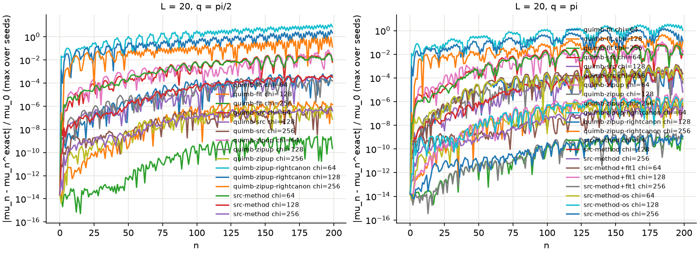
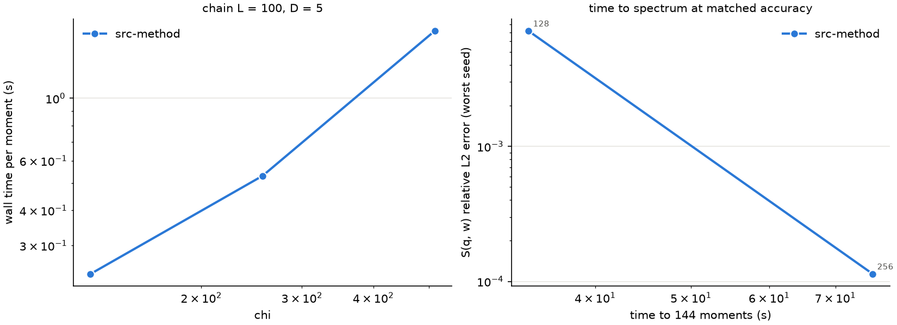
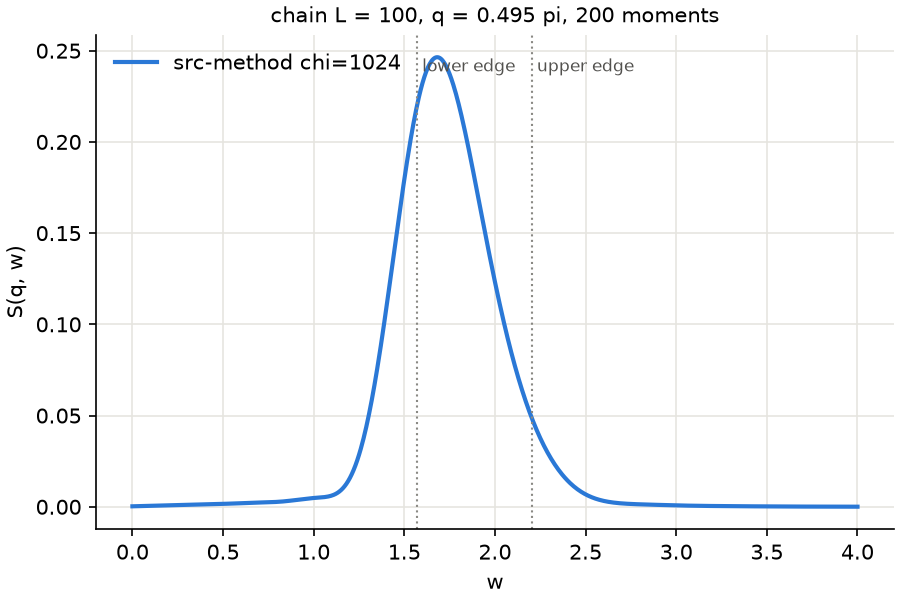
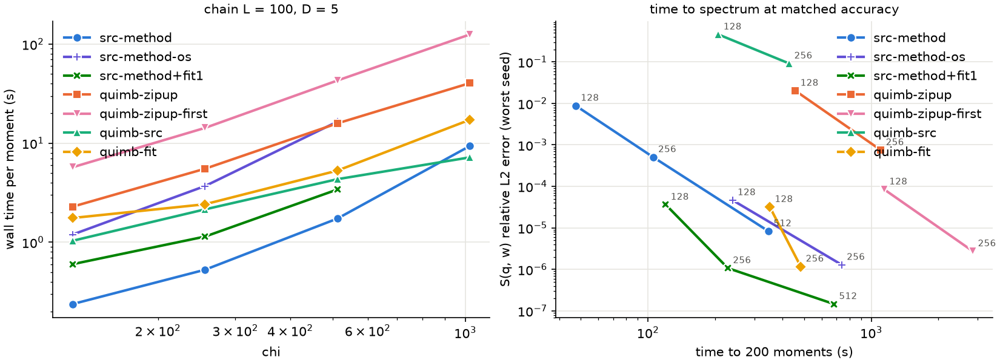
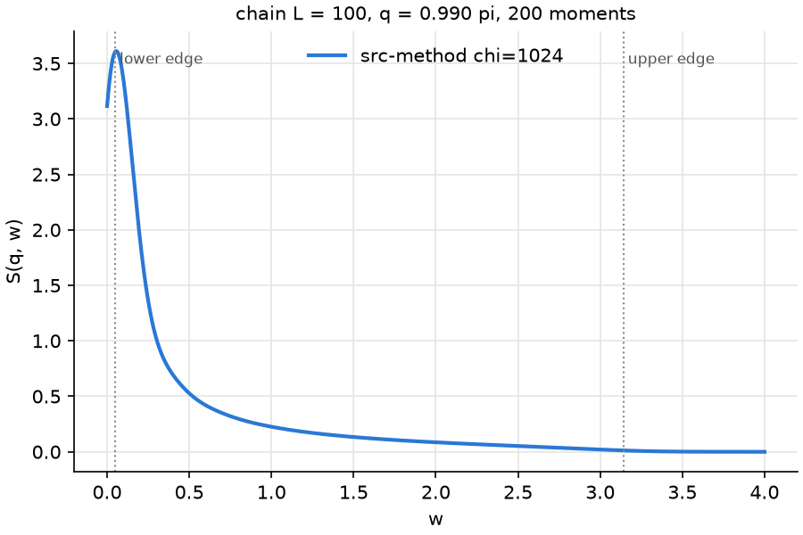
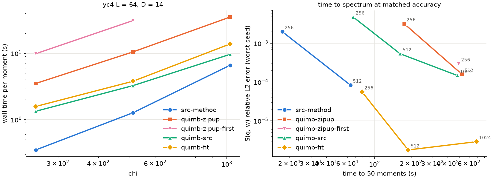
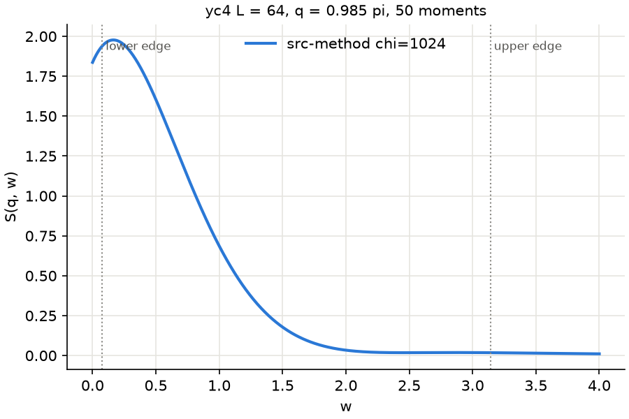

# Chebyshev MPS spectral functions: src-method against quimb

## Provenance

src-method 0.5.2.dev3+gf8d0f6f76, quimb 1.15.0, CuPy 14.2.0, NumPy 2.4.4, CUDA runtime 13020, driver 13040, NVIDIA A100-SXM-64GB, TeNPy 1.1.1. `SRC_EINSUM_OPTIMIZE` unset (src-method's default `dp` paths). Jobs: 62438530, 62439612, 62442407, 62442408, 62444886, 62444887, 62447531, 62447668, 62449018, 62449594, 62450796, 62453288, 62453444, 62453583, 62453864, 62454348, 62454374, 62454828, 62456653, 62531768, 62531769.

## Checks

| check | value |
|---|---|
| apply_vs_dense_L8 | 1.58e-15 |
| apply_exact_vs_dense_L8 | 3.51e-16 |
| compress_sum_vs_dense_L8 | 2.06e-15 |
| inner_vs_dense_L8 | 1.35e-14 |
| quimb-zipup_apply_vs_dense_L8 | 2.58e-15 |
| quimb-zipup_sum_vs_dense_L8 | 3.25e-15 |
| quimb-src_apply_vs_dense_L8 | 1.17e-15 |
| quimb-src_sum_vs_dense_L8 | 2.24e-15 |
| quimb-fit_apply_vs_dense_L8 | 1.27e-15 |
| quimb-fit_sum_vs_dense_L8 | 2.12e-15 |
| cylinder_2x4_D | 14 |
| cylinder_2x4_vs_dense | 0.00e+00 |
| cylinder_4x16_D | 14 |

## Ground states

| model | sites | D | E0 | Emax | a | DMRG sweeps | rel. change | bond | q (k) | t0 bond | mu0 |
|---|---|---|---|---|---|---|---|---|---|---|---|
| chain | 100 | 5 | -44.1277398929 | 24.750000 | 34.8748 | 7 | 6.2e-11 | 182 | 0.4950 pi (50) | 364 | 0.156522 |
| chain | 100 | 5 | -44.1277398929 | 24.750000 | 34.8748 | 7 | 6.2e-11 | 182 | 0.9901 pi (100) | 364 | 1.483266 |
| chain | 20 | 5 | -8.6824733344 | 4.750000 | 6.8013 | 4 | 3.4e-12 | 51 | 0.5238 pi (11) | 102 | 0.215524 |
| chain | 20 | 5 | -8.6824733344 | 4.750000 | 6.8013 | 4 | 3.4e-12 | 51 | 0.9524 pi (20) | 102 | 0.976802 |
| yc4 | 64 | 14 | -43.0589035377 | 31.000000 | 37.4982 | 9 | 2.2e-11 | 256 | 0.4923 pi (32) | 512 | 0.244335 |
| yc4 | 64 | 14 | -43.0589035377 | 31.000000 | 37.4982 | 9 | 2.2e-11 | 256 | 0.9846 pi (64) | 512 | 2.262852 |

## Phase 1: chain L = 20 against exact moments

DMRG E0 -8.682473334363; <psi0|H|psi0> with the sparse H -8.682473334363. Error `max_n |mu_n - mu_n^exact| / mu_0` over the moments each run reached (all seeds: max).

| q | method | chi | moments | max error | error at last moment |
|---|---|---|---|---|---|
| half | quimb-fit | 64 | 200 | 6.18e-04 | 4.71e-04 |
| half | quimb-fit | 128 | 200 | 3.02e-06 | 1.42e-06 |
| half | quimb-fit | 256 | 200 | 2.62e-09 | 2.27e-10 |
| half | quimb-src | 64 | 200 | 4.03e-02 | 6.57e-03 |
| half | quimb-src | 128 | 200 | 4.45e-04 | 3.37e-04 |
| half | quimb-src | 256 | 200 | 9.14e-07 | 4.17e-07 |
| half | quimb-zipup | 64 | 200 | 7.38e-02 | 1.22e-02 |
| half | quimb-zipup | 128 | 200 | 3.13e-04 | 1.56e-04 |
| half | quimb-zipup | 256 | 200 | 1.23e-06 | 7.72e-08 |
| half | quimb-zipup-rightcanon | 64 | 200 | 1.27e+01 | 7.48e+00 |
| half | quimb-zipup-rightcanon | 128 | 200 | 3.86e+00 | 2.19e+00 |
| half | quimb-zipup-rightcanon | 256 | 200 | 9.65e-01 | 1.36e-01 |
| half | src-method | 64 | 200 | 3.14e-02 | 8.90e-03 |
| half | src-method | 128 | 200 | 4.62e-04 | 3.24e-04 |
| half | src-method | 256 | 200 | 6.96e-07 | 4.05e-07 |
| pi | quimb-fit | 64 | 200 | 7.09e-04 | 7.58e-05 |
| pi | quimb-fit | 128 | 200 | 2.58e-06 | 7.64e-07 |
| pi | quimb-fit | 256 | 200 | 1.45e-09 | 7.13e-10 |
| pi | quimb-src | 64 | 200 | 7.03e-02 | 1.98e-02 |
| pi | quimb-src | 128 | 200 | 5.80e-04 | 6.45e-06 |
| pi | quimb-src | 256 | 200 | 1.02e-06 | 5.21e-07 |
| pi | quimb-zipup | 64 | 200 | 1.13e-01 | 1.05e-02 |
| pi | quimb-zipup | 128 | 200 | 9.90e-04 | 3.70e-05 |
| pi | quimb-zipup | 256 | 200 | 1.79e-06 | 4.93e-07 |
| pi | quimb-zipup-rightcanon | 64 | 200 | 3.52e+00 | 1.06e+00 |
| pi | quimb-zipup-rightcanon | 128 | 200 | 1.48e+00 | 1.38e-01 |
| pi | quimb-zipup-rightcanon | 256 | 200 | 4.71e-01 | 1.11e-01 |
| pi | src-method | 64 | 200 | 5.63e-02 | 9.27e-03 |
| pi | src-method | 128 | 200 | 4.71e-04 | 8.40e-05 |
| pi | src-method | 256 | 200 | 4.91e-07 | 2.74e-07 |
| pi | src-method+fit1 | 64 | 200 | 1.33e-03 | 2.29e-04 |
| pi | src-method+fit1 | 128 | 200 | 4.49e-06 | 1.88e-06 |
| pi | src-method+fit1 | 256 | 200 | 2.67e-09 | 1.16e-09 |
| pi | src-method-os | 64 | 200 | 1.05e-03 | 6.92e-05 |
| pi | src-method-os | 128 | 200 | 3.14e-06 | 1.33e-06 |
| pi | src-method-os | 256 | 200 | 1.75e-09 | 1.07e-09 |

## chain L = 100 (MPO bond D = 5)

### q = 0.4950 pi, 200 moments

Reference: src-method chi = 1024, seed 0. Against chi = 512: max moment difference 1.3e-03 (of mu_0), S(q, w) difference 9.8e-06 (relative L2 over w in [0, 4]).

Physics check: edges 1.571 and 2.204; with the kernel width pi a / N = 0.548, 98.4% of the reference weight lies in [1.023, 2.752].

Runs shorter than the reference are timing-only (errors `-`).

| method | chi | seeds | steps | apply s | compress s | s / moment | time for 200 moments s | pool GB | max moment error | S error |
|---|---|---|---|---|---|---|---|---|---|---|
| src-method | 128 | 3 | 100 | 0.231 | 0.245 | 0.238 | 48 | 0.8 | 4.8e-01 | 1.8e-02 |
| src-method | 256 | 3 | 100 | 0.352 | 0.709 | 0.530 | 106 | 1.6 | 4.8e-02 | 3.3e-04 |
| src-method | 512 | 3 | 100 | 0.916 | 2.543 | 1.729 | 346 | 5.2 | 1.3e-03 | 9.8e-06 |
| src-method | 1024 | 1 | 100 | 4.977 | 13.478 | 9.228 | 1846 | 18.5 | ref | ref |

### q = 0.9901 pi, 200 moments

Reference: src-method chi = 1024, seed 0. Against chi = 512: max moment difference 1.1e-02 (of mu_0), S(q, w) difference 6.0e-06 (relative L2 over w in [0, 4]).

Physics check: edges 0.049 and 3.141; with the kernel width pi a / N = 0.548, 100.0% of the reference weight lies in [0.000, 3.689].

Runs shorter than the reference are timing-only (errors `-`).

| method | chi | seeds | steps | apply s | compress s | s / moment | time for 200 moments s | pool GB | max moment error | S error |
|---|---|---|---|---|---|---|---|---|---|---|
| src-method | 128 | 3 | 100 | 0.230 | 0.245 | 0.238 | 48 | 0.8 | 7.2e-01 | 8.8e-03 |
| src-method | 256 | 3 | 100 | 0.347 | 0.708 | 0.528 | 106 | 1.6 | 1.7e-01 | 5.1e-04 |
| src-method | 512 | 3 | 100 | 0.915 | 2.539 | 1.733 | 347 | 5.2 | 1.2e-02 | 8.3e-06 |
| src-method | 1024 | 1 | 100 | 5.040 | 13.669 | 9.355 | 1871 | 18.5 | ref | ref |
| src-method-os | 128 | 1 | 100 | 1.182 | 1.210 | 1.196 | 239 | 0.8 | 8.1e-03 | 4.7e-05 |
| src-method-os | 256 | 1 | 100 | 3.504 | 3.877 | 3.690 | 738 | 1.7 | 2.4e-04 | 1.3e-06 |
| src-method-os | 512 | 1 | 7 | 15.238 | 17.756 | 16.497 | 3299 | 4.1 | - | - |
| src-method+fit1 | 128 | 1 | 100 | 0.490 | 0.711 | 0.600 | 120 | 1.3 | 7.3e-03 | 3.6e-05 |
| src-method+fit1 | 256 | 1 | 100 | 0.822 | 1.458 | 1.140 | 228 | 2.5 | 1.9e-04 | 1.1e-06 |
| src-method+fit1 | 512 | 1 | 100 | 2.314 | 4.498 | 3.406 | 681 | 8.0 | 7.2e-05 | 1.5e-07 |
| quimb-zipup | 128 | 1 | 100 | 2.261 | 2.311 | 2.286 | 457 | 3.8 | 2.8e+00 | 2.0e-02 |
| quimb-zipup | 256 | 1 | 100 | 5.386 | 5.655 | 5.521 | 1104 | 7.6 | 1.4e-01 | 7.5e-04 |
| quimb-zipup | 512 | 1 | 15 | 14.643 | 17.060 | 15.852 | 3170 | 29.4 | - | - |
| quimb-zipup | 1024 | 1 | 2 | 40.973 | 39.762 | 40.367 | 8073 | 51.9 | - | - |
| quimb-zipup-first | 128 | 1 | 100 | 6.303 | 5.130 | 5.717 | 1143 | 3.7 | 4.6e-03 | 8.5e-05 |
| quimb-zipup-first | 256 | 1 | 100 | 16.131 | 12.397 | 14.264 | 2853 | 7.0 | 1.3e-04 | 2.7e-06 |
| quimb-zipup-first | 512 | 1 | 15 | 49.749 | 36.111 | 42.930 | 8586 | 24.9 | - | - |
| quimb-zipup-first | 1024 | 1 | 2 | 171.666 | 78.461 | 125.064 | 25013 | 60.7 | - | - |
| quimb-src | 128 | 1 | 100 | 1.037 | 1.031 | 1.034 | 207 | 1.5 | 3.8e+01 | 4.6e-01 |
| quimb-src | 256 | 1 | 100 | 2.151 | 2.143 | 2.147 | 429 | 4.3 | 1.4e+01 | 9.1e-02 |
| quimb-src | 512 | 1 | 15 | 4.223 | 4.436 | 4.330 | 866 | 8.0 | - | - |
| quimb-src | 1024 | 1 | 8 | 5.829 | 8.546 | 7.187 | 1437 | 10.0 | - | - |
| quimb-fit | 128 | 1 | 100 | 1.875 | 1.637 | 1.756 | 351 | 2.2 | 8.1e-03 | 3.2e-05 |
| quimb-fit | 256 | 1 | 100 | 2.472 | 2.363 | 2.417 | 483 | 4.8 | 2.4e-04 | 1.2e-06 |
| quimb-fit | 512 | 1 | 15 | 5.303 | 5.269 | 5.286 | 1057 | 20.9 | - | - |
| quimb-fit | 1024 | 1 | 8 | 16.616 | 17.826 | 17.221 | 3444 | 56.1 | - | - |

## yc4 L = 64 (MPO bond D = 14)

### q = 0.9846 pi, 50 moments

Reference: src-method chi = 1024, seed 0. Against chi = 512: max moment difference 1.7e-03 (of mu_0), S(q, w) difference 8.3e-05 (relative L2 over w in [0, 4]).

Physics check: edges 0.076 and 3.141; with the kernel width pi a / N = 2.356, 99.7% of the reference weight lies in [0.000, 5.497].

Runs shorter than the reference are timing-only (errors `-`).

| method | chi | seeds | steps | apply s | compress s | s / moment | time for 50 moments s | pool GB | max moment error | S error |
|---|---|---|---|---|---|---|---|---|---|---|
| src-method | 256 | 1 | 25 | 0.259 | 0.438 | 0.348 | 17 | 1.6 | 3.5e-02 | 2.0e-03 |
| src-method | 512 | 1 | 25 | 0.874 | 1.659 | 1.267 | 63 | 3.8 | 1.7e-03 | 8.3e-05 |
| src-method | 1024 | 1 | 25 | 5.126 | 8.087 | 6.607 | 330 | 14.9 | ref | ref |
| quimb-zipup | 256 | 1 | 25 | 3.599 | 3.415 | 3.507 | 175 | 6.3 | 2.9e-02 | 3.2e-03 |
| quimb-zipup | 512 | 1 | 25 | 10.976 | 9.993 | 10.484 | 524 | 12.1 | 3.6e-03 | 1.6e-04 |
| quimb-zipup | 1024 | 1 | 4 | 36.947 | 33.529 | 35.238 | 1762 | 56.1 | - | - |
| quimb-zipup-first | 256 | 1 | 25 | 12.138 | 7.573 | 9.855 | 493 | 5.6 | 1.7e-03 | 3.0e-04 |
| quimb-zipup-first | 512 | 1 | 9 | 39.801 | 22.472 | 31.137 | 1557 | 13.6 | - | - |
| quimb-src | 256 | 1 | 25 | 1.347 | 1.323 | 1.335 | 67 | 3.7 | 6.5e-02 | 4.7e-03 |
| quimb-src | 512 | 1 | 25 | 3.320 | 3.181 | 3.250 | 163 | 10.0 | 6.2e-03 | 5.3e-04 |
| quimb-src | 1024 | 1 | 25 | 9.916 | 9.368 | 9.642 | 482 | 39.4 | 1.9e-03 | 1.5e-04 |
| quimb-fit | 256 | 1 | 25 | 1.741 | 1.414 | 1.578 | 79 | 4.6 | 7.2e-04 | 5.6e-05 |
| quimb-fit | 512 | 1 | 25 | 4.497 | 3.071 | 3.784 | 189 | 10.2 | 5.6e-05 | 1.8e-06 |
| quimb-fit | 1024 | 1 | 25 | 17.623 | 10.047 | 13.835 | 692 | 39.5 | 8.2e-05 | 2.9e-06 |

## Conclusion

Measured on one A100-SXM-64GB per job, complex128. src-method is the released
pipeline with its default `dp` paths, `oversample=1.0`, `cutoff=0`. quimb runs on
the same GPU with its defaults (`cutoff=0` only). Times are medians over steps;
one step is one `apply` and one compression of the three-term sum, and yields two
moments.

**Bottom line.** src-method is the fastest per moment up to `chi = 512`, by
2.5-24x over each quimb method. At matched accuracy it wins only for S(q, w)
errors above about 1e-5; below that, quimb's variational `fit` is faster, because
at equal `chi` it is 35-430x more accurate. The SRC-versus-zip-up gap does not
grow with the MPO bond: it is about 10x for D = 5 and for D = 14. On this
evidence, Chebyshev spectral functions are not yet a clear flagship for SRC. The
case rests on memory (below) and on the sum step, not on raw time to spectrum.
The follow-up below qualifies this: src-method followed by a single fit sweep is
2-3x faster than quimb fit at matched accuracy down to 1e-6. The application was
dropped before that was explored further.

### Time to spectrum at matched accuracy

Chain L = 100, q = 0.990 pi, 200 moments (from the plot and table above):

| target S error | fastest | runner-up |
|---|---|---|
| ~1e-2 | src-method chi 128: 48 s (8.8e-3) | quimb zipup chi 128: 457 s (2.0e-2) |
| ~5e-4 | src-method chi 256: 106 s (5.1e-4) | quimb zipup chi 256: 1104 s (7.5e-4) |
| ~1e-5 | src-method chi 512: 347 s (8.3e-6) | quimb fit chi 128: 351 s (3.2e-5) |
| ~1e-6 | quimb fit chi 256: 483 s (1.2e-6) | src-method needs chi 1024: 1871 s |

YC4 cylinder (D = 14), 50 moments: src-method `chi = 512` reaches 8.3e-5 in 63 s
and quimb fit `chi = 256` 5.6e-5 in 79 s, a near tie. quimb fit `chi = 512`
reaches 1.8e-6 in 189 s; src-method's `chi = 1024` reference takes 330 s.

### Follow-up: oversampling and SRC + one fit sweep (chain, q = pi)

Added after the conclusion above; it changes the matched-accuracy picture.
`src-method+fit1` is src-method followed by one quimb `fit` sweep (warm start,
`max_iterations=1`) on both the apply and the sum; `src-method-os` is
src-method with `oversample=None`. One seed, 100 steps (200 moments).

| method | chi | s / moment | 200 moments | S error |
|---|---|---|---|---|
| src-method+fit1 | 128 | 0.60 | 120 s | 3.6e-5 |
| src-method+fit1 | 256 | 1.14 | 228 s | 1.1e-6 |
| src-method+fit1 | 512 | 3.41 | 681 s | 1.5e-7 |
| src-method-os | 128 | 1.20 | 239 s | 4.7e-5 |
| src-method-os | 256 | 3.69 | 738 s | 1.3e-6 |
| src-method-os | 512 | 16.5 | (4 steps, stopped) | - |
| quimb fit | 128 | 1.76 | 351 s | 3.2e-5 |
| quimb fit | 256 | 2.42 | 483 s | 1.2e-6 |

- The hybrid is 2.1-2.9x faster than quimb fit at matched accuracy and beats
  plain src-method at every accuracy measured; at L = 20 it matches fit's
  accuracy per `chi`.
- `oversample=None` buys the same accuracy per `chi` as the fit sweep but costs
  2-3x more than the hybrid, and 5-10x more than plain src-method.
- 1.5e-7 is below the reference's resolution (src-method `chi = 1024`); it shows
  agreement, not a measured error.
- The capacity probes (largest `chi` per method on one card; src-method on 4
  GPUs) were cancelled before running when the application was dropped.

### Speed per moment and the D scaling

| s / moment | chi 128 | chi 256 | chi 512 | chi 1024 |
|---|---|---|---|---|
| chain D = 5, src-method | 0.24 | 0.53 | 1.73 | 9.4 |
| chain, quimb zipup | 2.29 | 5.52 | 15.9 | 40.4 (OOM at step 3) |
| chain, quimb src | 1.03 | 2.15 | 4.33 | **7.2** |
| chain, quimb fit | 1.76 | 2.42 | 5.29 | 17.2 |
| cylinder D = 14, src-method | | 0.35 | 1.27 | 6.6 |
| cylinder, quimb zipup | | 3.51 | 10.5 | 35.2 |
| cylinder, quimb src | | 1.34 | 3.25 | 9.6 |
| cylinder, quimb fit | | 1.58 | 3.78 | 13.8 |

- **zipup / src-method:** 9.6, 10.5, 9.1 and 4.3 on the chain; 10.1, 8.3 and
  5.3 on the cylinder. The ratio does not grow with D, and it shrinks with `chi`.
- **SRC loses at `chi = 1024` on the chain:** quimb's own SRC takes 7.2 s per
  moment against 9.4 s for src-method. src-method's time is dominated by the
  compression of the sum (bond `3 chi`): 13.7 s of compress against 5.0 s of
  apply. Its lead over quimb src falls from 4.3x at `chi = 128` to 0.77x.
- **quimb zipup-first** (oversampled zip-up) is accurate but the slowest method,
  at 24-28x src-method.

### Memory

Peak CuPy pool at `chi = 1024`: src-method 18.5 GB (chain) and 14.9 GB
(cylinder); quimb src 10 GB and 39 GB; quimb fit 56 GB and 40 GB. Both quimb
zip-ups exceed the 64 GB card on the chain, in the sum compression at step 3
(zipup at 52 GB, zipup-first at 61 GB). src-method is the only method below
20 GB on both models.

### Accuracy

- **Phase 1 (L = 20, against exact sparse moments, 200 moments):** src-method,
  quimb src, zipup (with left-canonical input) and fit all converge with `chi`;
  the worst error / mu_0 at `chi = 256` is 7e-7, 1e-6, 2e-6 and 3e-9.
- **Equal chi:** quimb fit is 35-430x more accurate than src-method in S(q, w),
  and zipup-first 7-190x. Without oversampling, SRC pays for its speed in accuracy
  per `chi`; `oversample` was left at its default, as the brief specifies.
- **quimb src at L = 100, q = pi** degrades badly (moment error 38 and 14 at
  `chi = 128, 256`; S error 0.46 and 0.09), although it matches src-method at
  L = 20 and on the cylinder. Not diagnosed.
- **Reference:** src-method `chi = 1024`, seed 0. Against `chi = 512` it
  differs by 6e-6 (chain, q = pi), 1e-5 (q = pi/2) and 8e-5 (cylinder) in S(q, w).
  quimb fit at `chi = 512` and `1024` lands 2-3e-6 from it on the cylinder, so
  errors near 1e-6 are at the reference's own resolution.
- **Physics check:** 98.4% (q = pi/2) and 100% (q = pi) of the reference weight
  lies between the des Cloizeaux-Pearson and two-spinon edges, widened by the
  kernel width. That width, pi a / N = 0.55 for 200 moments (the full bandwidth
  is about 69), is too coarse to resolve the continuum. Energy truncation, or
  many more moments, is needed for useful lineshapes; on the cylinder, 50 moments
  give a width of 2.4.

### Findings about the stack (not about SRC)

- **autoray:** quimb 1.15 on CuPy 14 needs autoray 0.11 (installed in the venv
  only). autoray 0.8.10 uses the unhashable CuPy `Device` as a cache key and
  fails in every decomposition.
- **quimb on cupy:** quimb's `src` noise and `fit` initial guess are drawn with
  numpy whatever the backend; a shim moves them to the device.
- **quimb `apply_op_vec`:** `tensor_network_apply_op_vec(..., compress=True,
  method=...)` on an MPS calls `MPS.compress`, whose `method` is the
  decomposition. zipup, src and fit need a lazy apply followed by
  `tensor_network_1d_compress`.
- **quimb `zipup` is not exact at full bond** (`diagnose_zipup.json`: 14-60% on
  a 12-site state at `chi = 64`, in any gauge). Fed right-canonical input, its
  L = 20 moments diverge (`quimb-zipup-rightcanon` rows: errors 0.5-13).
  Left-canonicalising the input, timed and used in every reported zipup run,
  makes them converge.
- **DMRG top state:** from a random start, DMRG on -H crept towards the
  ferromagnetic multiplet (a Dicke state of bond n/2 + 1) and had not converged
  after 14 sweeps on 100 sites. The chain's top-state DMRG starts from
  |up...up>; the cylinder's converged from a random start.

### Coverage and caveats

- **src-method:** 3 seeds at `chi <= 512` on the chain, both q, 100 steps;
  1 seed at `chi = 1024`; 1 seed on the cylinder.
- **quimb:** q = pi only, one seed. 100 steps at `chi <= 256`. Timing-only
  (15, 8, 2-4 steps) at `chi = 512, 1024`, and for zipup-first at `chi = 512`
  on the cylinder (9 steps). zipup-first on the cylinder at `chi = 1024` was not
  run.
- **Race:** two jobs once ran the same cylinder `chi = 1024` configurations at
  once and corrupted their files. Both were cancelled, the files deleted and the
  runs redone in one job; the reported timings agree with both overlapping runs
  (quimb src 19.3 s per step).
- **Not done:** the optional TDVP baseline.
