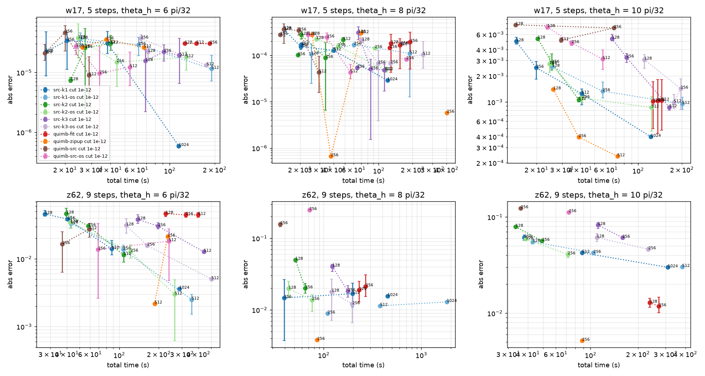

# Kicked Ising: Heisenberg MPO, src-method against quimb

## Provenance

```json
{
 "src_method": "0.5.2.dev2+gdc6ecf6df",
 "quimb": "1.15.0",
 "autoray": "0.11.0",
 "opt_einsum": "3.4.0",
 "numpy": "2.4.4",
 "cupy": "14.2.0",
 "cuda_runtime": 13020,
 "cuda_driver": 13040,
 "gpu": "NVIDIA A100-SXM-64GB",
 "gpus_visible": 1,
 "qiskit": "2.6.1",
 "qiskit_ibm_runtime": "0.51.0",
 "stim": "1.16.0",
 "python": "3.14.2",
 "host": "lrdn0099.leonardo.local",
 "slurm_job": "62546160"
}
```

## Geometry

qiskit_ibm_runtime FakeKyiv (ibm_kyiv, Eagle r3): 127 qubits, 144 edges. Ordering: chain site = qubit label (Kim et al. SI Fig. S9b 'IBM' order). The largest number of gates over one cut is 6, so 6 sub-layers with at most one gate per cut is optimal; Anand et al. used 13. Longest gate: 15 sites.

| sub-layer | gates | U bond | U^dag bond | cuts at bond 2 |
|---|---|---|---|---|
| 0 | 64 | 2 | 2 | 123 |
| 1 | 34 | 2 | 2 | 115 |
| 2 | 15 | 2 | 2 | 106 |
| 3 | 18 | 2 | 2 | 97 |
| 4 | 11 | 2 | 2 | 73 |
| 5 | 2 | 2 | 2 | 30 |

## Checks

Dense operator, 12-qubit heavy hexagon (qubits [0, 1, 2, 3, 4, 14, 15, 18, 19, 20, 21, 22]), 2 sub-layers, theta_h = 0.8876, 2 steps, O = YZYZZIIXXZZI, full bond 4096. qiskit statevector against the dense reference: 6.9e-17.

| method | relative Frobenius error of U^dag O U |
|---|---|
| src-k1 | 2.8e-15 |
| src-k1-os | 6.9e-15 |
| src-k2 | 2.1e-15 |
| src-k2-os | 8.4e-15 |
| src-k3 | 2.1e-15 |
| src-k3-os | 8.4e-15 |
| quimb-fit | 4.1e-15 |
| quimb-zipup | 1.1e-14 |
| quimb-src | 4.8e-15 |
| quimb-src-os | 7.6e-15 |
| quimb-src-default | 4.8e-15 |
| quimb-src-os-default | 7.6e-15 |

Stack order:

- src(Bd, Ad, O, A, B) vs Bd Ad O A B: 1.9e-15
- reversed stack vs Bd Ad O A B: 1.4e+00

16-qubit fragment (qubits [0, 1, 2, 3, 4, 5, 6, 14, 15, 18, 19, 20, 21, 22, 23, 24]), theta_h = 0.5597, 3 steps, O = IZIIZZZZIIZIIIXY, chi = 4096: <0|O|0> against qiskit (-0.057633).

| method | abs error | max bond |
|---|---|---|
| src-k1 | 1.4e-16 | 256 |
| src-k1-os | 2.7e-15 | 256 |
| src-k2 | 1.2e-15 | 256 |
| src-k2-os | 8.0e-16 | 256 |
| src-k3 | 2.1e-16 | 256 |
| src-k3-os | 4.9e-17 | 256 |
| quimb-fit | 8.5e-16 | 256 |
| quimb-zipup | 5.7e-16 | 256 |
| quimb-src | 6.2e-16 | 256 |
| quimb-src-os | 4.9e-16 | 256 |
| quimb-src-default | 6.2e-16 | 256 |
| quimb-src-os-default | 4.9e-16 | 256 |

Clifford points (127 qubits, chi = 16) against stim:

- w10_is_U5_Z13_U5dag: matches the paper's string up to sign: True
- w17_is_U5_Z58_U5dag: matches the paper's string up to sign: True

| case | stim | method | abs error | max bond |
|---|---|---|---|---|
| z62_20steps_k0 | 1 | src-k1 | 3.5e-13 (max over steps 3.5e-13) | 1 |
| z62_20steps_k0 | 1 | src-k1-os | 2.5e-14 (max over steps 4.9e-14) | 1 |
| z62_20steps_k0 | 1 | src-k2 | 2.6e-13 (max over steps 2.6e-13) | 1 |
| z62_20steps_k0 | 1 | src-k3 | 1.9e-13 (max over steps 1.9e-13) | 1 |
| z62_20steps_k0 | 1 | quimb-fit | 4.8e-13 (max over steps 4.8e-13) | 1 |
| z62_20steps_k0 | 1 | quimb-zipup | 3.4e-13 (max over steps 3.4e-13) | 2 |
| z62_20steps_k0 | 1 | quimb-src | 1.1e-12 (max over steps 1.1e-12) | 1 |
| z62_20steps_k0 | 1 | quimb-src-os | 9.1e-13 (max over steps 9.1e-13) | 1 |
| z62_20steps_k16 | 0 | src-k1 | 0.0e+00 | 1 |
| z62_20steps_k16 | 0 | src-k1-os | 0.0e+00 | 1 |
| z62_20steps_k16 | 0 | src-k2 | 0.0e+00 | 1 |
| z62_20steps_k16 | 0 | src-k3 | 0.0e+00 | 2 |
| z62_20steps_k16 | 0 | quimb-fit | 0.0e+00 | 1 |
| z62_20steps_k16 | 0 | quimb-zipup | 0.0e+00 | 2 |
| z62_20steps_k16 | 0 | quimb-src | 0.0e+00 | 1 |
| z62_20steps_k16 | 0 | quimb-src-os | 0.0e+00 | 1 |
| w10_5steps_k16 | 1 | src-k1 | 9.7e-14 | 1 |
| w10_5steps_k16 | 1 | src-k1-os | 3.8e-14 | 1 |
| w10_5steps_k16 | 1 | src-k2 | 7.4e-14 | 1 |
| w10_5steps_k16 | 1 | src-k3 | 9.0e-14 | 1 |
| w10_5steps_k16 | 1 | quimb-fit | 6.5e-14 | 1 |
| w10_5steps_k16 | 1 | quimb-zipup | 2.3e-14 | 2 |
| w10_5steps_k16 | 1 | quimb-src | 2.4e-13 | 1 |
| w10_5steps_k16 | 1 | quimb-src-os | 1.2e-13 | 1 |
| w17_5steps_k16 | -1 | src-k1 | 1.2e-13 | 1 |
| w17_5steps_k16 | -1 | src-k1-os | 9.4e-14 | 1 |
| w17_5steps_k16 | -1 | src-k2 | 1.0e-13 | 1 |
| w17_5steps_k16 | -1 | src-k3 | 7.2e-14 | 1 |
| w17_5steps_k16 | -1 | quimb-fit | 8.4e-14 | 1 |
| w17_5steps_k16 | -1 | quimb-zipup | 9.3e-15 | 2 |
| w17_5steps_k16 | -1 | quimb-src | 1.9e-13 | 1 |
| w17_5steps_k16 | -1 | quimb-src-os | 2.4e-13 | 1 |

## Host SVD failures of the released src-method

12 of 422 src-method runs without the fallback stopped with `LinAlgError: SVD did not converge` (numpy gesdd on the host, in `truncated_qr` or the oversampled truncation). Rerun with a gesvd fallback, they appear as `+gesvd` in the tables.

| run | step | error |
|---|---|---|
| w10:5:12:src-k1:384:0 | 5 | LinAlgError: SVD did not converge |
| w10:5:12:src-k1:512:0 | 5 | LinAlgError: SVD did not converge |
| w10:5:13:src-k1:384:0 | 5 | LinAlgError: SVD did not converge |
| w17:5:6:src-k1-os:256:1 | 5 | LinAlgError: SVD did not converge |
| w17:5:6:src-k3-os:256:0 | 5 | LinAlgError: SVD did not converge |
| w17:5:8:src-k2-os:128:1 | 5 | LinAlgError: SVD did not converge |
| w17:5:8:src-k2-os:256:0 | 4 | LinAlgError: SVD did not converge |
| z62:9:6:src-k2-os:128:1 | 8 | LinAlgError: SVD did not converge |
| z62:9:8:src-k1-os:256:1 | 8 | LinAlgError: SVD did not converge |
| z62:9:8:src-k1-os:512:1 | 7 | LinAlgError: SVD did not converge |
| z62:9:8:src-k2-os:128:2 | 7 | LinAlgError: SVD did not converge |
| z62:9:8:src-k3-os:256:2 | 7 | LinAlgError: SVD did not converge |

## Stage 1: exactly verifiable regime (5 steps, src-k1, seed 0)

w10: absolute error against BGC exact; `F` marks a failed run (host SVD did not converge), `*` a run with the gesvd fallback.

| theta_h / (pi/32) | exact | chi 128 | chi 256 | chi 384 | chi 512 | chi 1024 |
|---|---|---|---|---|---|---|
| 0 | 0 | 5.6e-78 | 2.9e-78 | 3.0e-78 | 2.6e-78 | 2.9e-78 |
| 1 | -2.48303e-05 | 4.8e-11 | 2.6e-12 | 1.7e-12 | 1.3e-12 | 1.6e-13 |
| 2 | -0.00060111 | 9.9e-08 | 2.8e-10 | 6.9e-12 | 1.4e-12 | 5.0e-15 |
| 3 | -0.00299498 | 2.2e-06 | 4.9e-09 | 1.8e-11 | 8.8e-13 | 3.8e-15 |
| 4 | -0.0077148 | 5.4e-05 | 2.8e-07 | 8.6e-10 | 4.0e-14 | 3.8e-16 |
| 5 | -0.0146206 | 4.9e-05 | 1.2e-05 | 4.2e-09 | 1.8e-14 | 4.4e-16 |
| 6 | -0.0233923 | 6.4e-04 | 3.6e-05 | 3.6e-15 | 6.8e-15 | 4.2e-16 |
| 7 | -0.0281306 | 3.9e-03 | 4.8e-05 | 7.0e-16 | 1.1e-15 | 2.8e-15 |
| 8 | -0.0128409 | 4.6e-03 | 3.8e-04 | 6.1e-15 | 2.1e-14 | 1.6e-16 |
| 9 | 0.0315001 | 8.8e-03 | 1.3e-03 | 3.0e-14 | 6.1e-14 | 3.7e-15 |
| 10 | 0.0943015 | 1.1e-02 | 1.0e-03 | 2.4e-14 | 2.0e-14 | 9.2e-15 |
| 11 | 0.178854 | 2.3e-03 | 1.5e-03 | 2.0e-14 | 1.4e-14 | 4.3e-15 |
| 12 | 0.317475 | 4.6e-03 | 1.1e-03 | F | F | 5.6e-15 |
| 13 | 0.521356 | 2.3e-03 | 1.7e-04 | F | 5.9e-14 | 3.5e-14 |
| 14 | 0.749026 | 6.9e-04 | 7.0e-06 | 1.7e-14 | 9.9e-14 | 1.0e-14 |
| 15 | 0.930311 | 5.8e-05 | 1.0e-08 | 9.7e-10 | 3.4e-15 | 1.7e-14 |
| 16 | 1 | 4.9e-15 | 7.3e-15 | 2.9e-14 | 1.5e-14 | 2.6e-14 |

w17: absolute error against BGC exact; `F` marks a failed run (host SVD did not converge), `*` a run with the gesvd fallback.

| theta_h / (pi/32) | exact | chi 128 | chi 256 | chi 512 | chi 1024 |
|---|---|---|---|---|---|
| 0 | -0 | - | 0.0e+00 | 1.9e-141 | 3.6e-140 |
| 1 | 6.14478e-10 | - | 1.7e-12 | 3.1e-13 | 2.9e-14 |
| 2 | 1.22814e-07 | - | 5.7e-10 | 1.8e-10 | 3.0e-10 |
| 3 | 1.0928e-06 | - | 4.4e-08 | 2.2e-08 | 5.4e-09 |
| 4 | 2.93232e-06 | - | 1.5e-07 | 1.3e-06 | 2.0e-07 |
| 5 | 9.65753e-06 | - | 5.7e-06 | 2.9e-06 | 9.9e-07 |
| 6 | 3.05633e-05 | 1.0e-05 | 1.1e-05 | 2.3e-05 | 5.9e-07 |
| 7 | 3.78007e-05 | - | 3.8e-05 | 8.7e-05 | 4.3e-05 |
| 8 | -4.36173e-05 | 4.1e-04 | 1.5e-04 | 1.5e-04 | 2.9e-05 |
| 9 | -0.000862057 | - | 5.3e-04 | 1.7e-04 | 1.2e-04 |
| 10 | -0.00737913 | 5.6e-03 | 2.7e-03 | 1.4e-03 | 4.0e-04 |
| 11 | -0.0385285 | - | 5.7e-03 | 2.6e-03 | 9.1e-04 |
| 12 | -0.133408 | - | 4.7e-03 | 1.5e-03 | 3.1e-05 |
| 13 | -0.330267 | - | 3.4e-03 | 4.0e-04 | 3.7e-04 |
| 14 | -0.615178 | - | 8.4e-04 | 3.0e-04 | 1.2e-04 |
| 15 | -0.886311 | - | 3.8e-05 | 1.2e-05 | 9.4e-07 |
| 16 | -1 | - | 7.0e-14 | 4.0e-14 | 7.7e-14 |

## One compression of U^dag O U (z62:8:6, sub-layer 0, chi 256)

O is the observable evolved by src-k1 at bond 256 (input bond 255); the exact sandwich has bond 1020. Relative Frobenius error of the compressed operator and change of <0|.|0>, mean (min-max) over seeds.

| method | seeds | rel. Frobenius error | value error | seconds |
|---|---|---|---|---|
| svd-optimal | 1 | 0.033 (0.033-0.033) | 1.4e-04 | 10.0 |
| src-k1 | 5 | 0.080 (0.079-0.082) | 4.8e-03 | 1.4 |
| src-k1-os | 5 | 0.051 (0.050-0.051) | 2.0e-03 | 3.5 |
| quimb-src | 5 | 0.187 (0.180-0.203) | 1.3e-02 | 1.5 |
| quimb-src-os | 5 | 0.106 (0.101-0.111) | 9.4e-03 | 3.6 |
| quimb-fit | 5 | 0.116 (0.115-0.116) | 2.1e-03 | 21.1 |
| quimb-zipup | 1 | 0.056 (0.056-0.056) | 1.7e-03 | 6.8 |

## One compression of U^dag O U (z62:8:6, sub-layer 0, chi 64)

O is the observable evolved by src-k1 at bond 64 (input bond 64); the exact sandwich has bond 256. Relative Frobenius error of the compressed operator and change of <0|.|0>, mean (min-max) over seeds.

| method | seeds | rel. Frobenius error | value error | seconds |
|---|---|---|---|---|
| svd-optimal | 1 | 0.048 (0.048-0.048) | 1.6e-03 | 1.3 |
| src-k1 | 2 | 0.119 (0.117-0.121) | 7.6e-03 | 0.5 |
| src-k1-os | 2 | 0.075 (0.075-0.075) | 4.5e-03 | 0.9 |
| quimb-src | 2 | 0.234 (0.221-0.246) | 5.0e-02 | 0.6 |
| quimb-src-os | 2 | 0.127 (0.118-0.137) | 1.8e-02 | 1.2 |
| quimb-fit | 2 | 0.066 (0.066-0.066) | 5.2e-03 | 8.4 |
| quimb-zipup | 1 | 0.080 (0.080-0.080) | 1.9e-03 | 1.5 |

## Cost of one Trotter step at large chi (random saturated operator)

| method | chi | cutoff | groups done | step s (or partial) | TFLOP | TFLOP/s | GPU pool GB | host peak GB | input GB | tiers (first group) |
|---|---|---|---|---|---|---|---|---|---|---|
| src-k1 | 1024 | 0 | 6 | 66.1 | 418.7 | 6.34 | 9.1 | 17 | 7.9 | device: 127 |
| src-k1-os | 1024 | 0 | 3 partial | 438.8 | 496.6 | 1.13 | 14.0 | 27 | 7.9 | device: 127 |
| src-k1 | 1024 | 1e-12 | 4 partial | 209.4 | 312.7 | 1.49 | 9.1 | 16 | 7.9 | device: 127 |
| src-k1-os | 1024 | 1e-12 | 4 partial | 576.3 | 650.8 | 1.13 | 14.0 | 27 | 7.9 | device: 127 |
| src-k1 | 2048 | 0 | 6 | 334.1 | 3323.0 | 9.95 | 35.7 | 65 | 31.2 | device: 127 |
| src-k1-g4 | 2048 | 0 | 6 | 222.9 | 3324.6 | 14.92 | 9.5 | 65 | 31.2 | device: 127 |
| src-k1 | 2048 | 1e-12 | 2 partial | 811.4 | 1271.2 | 1.57 | 35.7 | 63 | 31.2 | device: 127 |
| src-k1-g2 | 2048 | 1e-12 | 2 partial | 732.3 | 1272.4 | 1.74 | 22.5 | 63 | 31.2 | device: 127 |
| src-k1-g4 | 4096 | 0 | 4 partial | 741.4 | 20054.2 | 27.05 | 37.7 | 257 | 124.1 | device: 127 |

## w17, 5 steps, theta_h = 6 pi/32 = 0.5890

Reference: 3.056326226e-05 (BGC exact)

| method | chi | runs done | s / step | total s | abs error (min-max) | 2^-n Tr O^dag O | bond | peak GB | TFLOP | TFLOP/s | decomp share |
|---|---|---|---|---|---|---|---|---|---|---|---|
| src-k1 cut 1e-12 | 128 | 3/3 | 2.211 | 14.9 | 2.22e-05 (8.72e-06-4.75e-05) | 0.6358 | 128 | 0.1 | 0.3 | 0.02 | 0.07 |
| src-k1 cut 1e-12 | 256 | 3/3 | 2.207 | 20.6 | 3.41e-05 (1.12e-05-4.71e-05) | 0.8608 | 256 | 0.3 | 1.7 | 0.08 | 0.08 |
| src-k1 cut 1e-12 | 512 | 3/3 | 2.262 | 38.4 | 3.08e-05 (2.07e-05-4.88e-05) | 0.9647 | 504 | 1.6 | 9.2 | 0.24 | 0.09 |
| src-k1 cut 1e-12 | 1024 | 1/1 | 3.648 | 115.0 | 5.89e-07 (5.89e-07-5.89e-07) | 0.9946 | 980 | 5.2 | 41.5 | 0.36 | 0.11 |
| src-k1-os cut 1e-12 | 128 | 3/3 | 4.296 | 25.3 | 3.67e-05 (2.60e-05-4.60e-05) | 0.8252 | 128 | 0.1 | 1.6 | 0.06 | 0.51 |
| src-k1-os cut 1e-12 | 256 | 2/2 | 10.489 | 61.8 | 2.90e-05 (1.90e-05-3.90e-05) | 0.9493 | 256 | 0.4 | 10.4 | 0.17 | 0.61 |
| src-k1-os cut 1e-12 | 512 | 3/3 | 28.077 | 190.1 | 1.15e-05 (7.19e-06-1.94e-05) | 0.9904 | 512 | 1.6 | 72.9 | 0.38 | 0.68 |
| src-k2 cut 1e-12 | 128 | 3/3 | 2.871 | 21.8 | 7.42e-06 (6.84e-06-8.23e-06) | 0.6531 | 128 | 0.3 | 0.5 | 0.03 | 0.03 |
| src-k2 cut 1e-12 | 256 | 3/3 | 3.177 | 27.2 | 2.59e-05 (2.48e-06-5.45e-05) | 0.8708 | 256 | 1.2 | 2.6 | 0.11 | 0.03 |
| src-k2 cut 1e-12 | 512 | 3/3 | 3.497 | 40.4 | 3.05e-05 (2.37e-05-4.19e-05) | 0.9678 | 510 | 5.4 | 13.0 | 0.35 | 0.03 |
| src-k2-os cut 1e-12 | 128 | 3/3 | 4.053 | 24.4 | 3.75e-05 (1.77e-05-6.53e-05) | 0.8232 | 128 | 0.3 | 1.5 | 0.07 | 0.26 |
| src-k2-os cut 1e-12 | 256 | 3/3 | 6.666 | 44.3 | 1.49e-05 (5.87e-06-2.01e-05) | 0.9478 | 256 | 1.2 | 8.9 | 0.22 | 0.36 |
| src-k2-os cut 1e-12 | 512 | 3/3 | 22.194 | 128.6 | 1.80e-05 (1.10e-05-2.23e-05) | 0.9902 | 512 | 5.0 | 56.5 | 0.45 | 0.44 |
| src-k3 cut 1e-12 | 128 | 3/3 | 9.746 | 68.8 | 1.56e-05 (2.22e-06-2.39e-05) | 0.6753 | 128 | 0.9 | 1.0 | 0.02 | 0.01 |
| src-k3 cut 1e-12 | 256 | 3/3 | 10.978 | 91.3 | 2.21e-05 (1.55e-05-2.91e-05) | 0.8788 | 256 | 4.0 | 4.8 | 0.07 | 0.01 |
| src-k3 cut 1e-12 | 512 | 3/3 | 12.873 | 116.4 | 1.92e-05 (6.54e-06-3.72e-05) | 0.9719 | 511 | 14.5 | 22.8 | 0.27 | 0.01 |
| src-k3-os cut 1e-12 | 128 | 3/3 | 9.490 | 71.4 | 2.21e-05 (1.67e-05-2.75e-05) | 0.8155 | 128 | 1.1 | 2.5 | 0.05 | 0.11 |
| src-k3-os cut 1e-12 | 256 | 2/2 | 10.324 | 64.2 | 3.70e-05 (3.15e-05-4.25e-05) | 0.9454 | 256 | 3.7 | 12.6 | 0.20 | 0.17 |
| src-k3-os cut 1e-12 | 512 | 3/3 | 24.693 | 176.6 | 1.32e-05 (1.25e-05-1.41e-05) | 0.9900 | 512 | 17.8 | 69.2 | 0.52 | 0.24 |
| quimb-fit cut 1e-12 | 128 | 3/3 | 20.485 | 126.2 | 3.06e-05 (2.99e-05-3.13e-05) | 0.3804 | 128 | 0.2 | 5.6 | 0.04 | 0.82 |
| quimb-fit cut 1e-12 | 256 | 3/3 | 21.738 | 185.7 | 3.05e-05 (3.00e-05-3.12e-05) | 0.3773 | 256 | 0.8 | 16.2 | 0.10 | 0.78 |
| quimb-fit cut 1e-12 | 512 | 3/3 | 21.451 | 150.9 | 3.05e-05 (3.00e-05-3.12e-05) | 0.3776 | 512 | 2.6 | 34.3 | 0.23 | 0.74 |
| quimb-zipup cut 1e-12 | 128 | 1/1 | 2.969 | 26.1 | 2.62e-05 (2.62e-05-2.62e-05) | 0.7844 | 128 | 0.5 | 2.6 | 0.10 | 0.96 |
| quimb-zipup cut 1e-12 | 256 | 1/1 | 3.035 | 37.7 | 3.57e-05 (3.57e-05-3.57e-05) | 0.9147 | 256 | 1.6 | 14.0 | 0.37 | 0.96 |
| quimb-zipup cut 1e-12 | 512 | 1/1 | 3.025 | 67.1 | 2.62e-05 (2.62e-05-2.62e-05) | 0.9772 | 512 | 5.3 | 77.0 | 1.15 | 0.96 |
| quimb-src cut 1e-12 | 128 | 3/3 | 2.346 | 14.6 | 2.09e-05 (1.60e-05-2.93e-05) | 0.5048 | 120 | 0.3 | 0.3 | 0.02 | 0.47 |
| quimb-src cut 1e-12 | 256 | 3/3 | 2.393 | 20.0 | 4.66e-05 (2.29e-05-6.02e-05) | 0.6929 | 233 | 1.1 | 1.6 | 0.08 | 0.56 |
| quimb-src cut 1e-12 | 512 | 3/3 | 2.224 | 28.9 | 8.96e-06 (3.88e-06-1.82e-05) | 0.8824 | 420 | 2.9 | 8.4 | 0.29 | 0.61 |
| quimb-src-os cut 1e-12 | 128 | 3/3 | 2.839 | 23.6 | 2.73e-05 (1.98e-05-3.26e-05) | 0.6546 | 128 | 0.3 | 0.9 | 0.04 | 0.59 |
| quimb-src-os cut 1e-12 | 256 | 3/3 | 2.964 | 33.9 | 9.65e-06 (3.96e-07-2.69e-05) | 0.8696 | 256 | 0.9 | 4.9 | 0.14 | 0.62 |
| quimb-src-os cut 1e-12 | 512 | 3/3 | 2.968 | 54.1 | 1.23e-05 (6.02e-06-2.20e-05) | 0.9618 | 512 | 2.7 | 26.0 | 0.48 | 0.64 |

## w17, 5 steps, theta_h = 8 pi/32 = 0.7854

Reference: -4.36172567e-05 (BGC exact)

| method | chi | runs done | s / step | total s | abs error (min-max) | 2^-n Tr O^dag O | bond | peak GB | TFLOP | TFLOP/s | decomp share |
|---|---|---|---|---|---|---|---|---|---|---|---|
| src-k1 | 256 | 1/1 | 4.293 | 20.6 | 1.70e-04 (1.70e-04-1.70e-04) | 0.3891 | 256 | 0.6 | 32.2 | 1.56 | 0.06 |
| src-k1 cut 1e-12 | 128 | 3/3 | 2.199 | 14.5 | 3.60e-04 (2.57e-04-4.15e-04) | 0.1684 | 128 | 0.2 | 0.3 | 0.02 | 0.07 |
| src-k1 cut 1e-12 | 256 | 3/3 | 2.224 | 20.4 | 1.54e-04 (1.34e-04-1.81e-04) | 0.3885 | 256 | 0.5 | 1.8 | 0.09 | 0.08 |
| src-k1 cut 1e-12 | 512 | 3/3 | 3.264 | 39.9 | 1.28e-04 (1.16e-04-1.47e-04) | 0.6476 | 509 | 1.7 | 9.7 | 0.25 | 0.09 |
| src-k1 cut 1e-12 | 1024 | 1/1 | 3.649 | 119.4 | 2.90e-05 (2.90e-05-2.90e-05) | 0.8620 | 1005 | 5.4 | 43.6 | 0.36 | 0.10 |
| src-k1-os | 256 | 1/1 | 31.458 | 157.2 | 1.75e-04 (1.75e-04-1.75e-04) | 0.5971 | 256 | 0.9 | 67.5 | 0.43 | 0.15 |
| src-k1-os cut 1e-12 | 128 | 3/3 | 4.533 | 25.2 | 1.05e-04 (2.46e-05-1.76e-04) | 0.3487 | 128 | 0.1 | 1.6 | 0.06 | 0.51 |
| src-k1-os cut 1e-12 | 256 | 3/3 | 10.115 | 60.3 | 1.70e-04 (1.50e-04-1.85e-04) | 0.5985 | 256 | 0.4 | 10.4 | 0.17 | 0.61 |
| src-k1-os cut 1e-12 | 512 | 3/3 | 28.879 | 187.8 | 1.10e-04 (1.27e-05-1.72e-04) | 0.8138 | 512 | 1.7 | 71.3 | 0.38 | 0.70 |
| src-k2 | 256 | 1/1 | 3.404 | 19.1 | 1.01e-04 (1.01e-04-1.01e-04) | 0.4052 | 256 | 2.2 | 49.9 | 2.61 | 0.02 |
| src-k2 cut 1e-12 | 128 | 3/3 | 2.832 | 20.4 | 2.78e-04 (2.24e-04-3.26e-04) | 0.1808 | 128 | 0.3 | 0.5 | 0.03 | 0.03 |
| src-k2 cut 1e-12 | 256 | 3/3 | 4.253 | 33.8 | 8.87e-05 (6.48e-06-1.86e-04) | 0.4037 | 256 | 1.2 | 2.6 | 0.09 | 0.03 |
| src-k2 cut 1e-12 | 512 | 3/3 | 6.335 | 48.3 | 2.15e-04 (1.78e-04-2.43e-04) | 0.6618 | 511 | 4.8 | 14.0 | 0.32 | 0.03 |
| src-k2-os | 256 | 1/1 | 18.119 | 92.2 | 1.44e-04 (1.44e-04-1.44e-04) | 0.5915 | 256 | 3.2 | 92.9 | 1.01 | 0.05 |
| src-k2-os cut 1e-12 | 128 | 2/3 | 3.970 | 27.9 | 2.25e-04 (2.15e-04-2.35e-04) (1 failed) | 0.3522 | 128 | 0.3 | 1.2 | 0.06 | 0.34 |
| src-k2-os cut 1e-12 | 256 | 2/2 | 6.217 | 43.6 | 1.57e-04 (1.35e-04-1.79e-04) | 0.5910 | 256 | 1.2 | 8.9 | 0.21 | 0.36 |
| src-k2-os cut 1e-12 | 512 | 3/3 | 16.437 | 115.4 | 4.79e-05 (4.32e-05-5.55e-05) | 0.8124 | 512 | 5.0 | 53.9 | 0.48 | 0.46 |
| src-k3 | 256 | 1/1 | 8.200 | 64.2 | 5.43e-05 (5.43e-05-5.43e-05) | 0.4163 | 256 | 7.8 | 102.4 | 1.60 | 0.01 |
| src-k3 cut 1e-12 | 128 | 3/3 | 9.809 | 65.7 | 3.08e-04 (2.15e-04-4.14e-04) | 0.1916 | 128 | 0.8 | 1.1 | 0.02 | 0.01 |
| src-k3 cut 1e-12 | 256 | 3/3 | 10.992 | 84.9 | 5.06e-05 (1.54e-06-8.23e-05) | 0.4149 | 256 | 4.4 | 4.9 | 0.09 | 0.01 |
| src-k3 cut 1e-12 | 512 | 3/3 | 12.532 | 112.3 | 4.81e-05 (1.70e-05-6.45e-05) | 0.6830 | 512 | 14.8 | 24.0 | 0.30 | 0.01 |
| src-k3-os | 256 | 1/1 | 19.907 | 127.0 | 6.76e-05 (6.76e-05-6.76e-05) | 0.5794 | 256 | 11.7 | 183.2 | 1.44 | 0.02 |
| src-k3-os cut 1e-12 | 128 | 3/3 | 9.472 | 71.1 | 2.10e-04 (1.97e-04-2.36e-04) | 0.3316 | 128 | 1.1 | 2.5 | 0.05 | 0.11 |
| src-k3-os cut 1e-12 | 256 | 3/3 | 12.911 | 98.6 | 6.69e-05 (3.86e-06-1.29e-04) | 0.5768 | 256 | 3.7 | 12.6 | 0.19 | 0.17 |
| src-k3-os cut 1e-12 | 512 | 3/3 | 30.944 | 246.3 | 1.03e-04 (5.29e-05-1.99e-04) | 0.8079 | 512 | 17.8 | 62.2 | 0.33 | 0.27 |
| quimb-fit | 256 | 1/1 | 25.131 | 125.3 | 1.45e-04 (1.45e-04-1.45e-04) | 0.7302 | 256 | 2.8 | 206.7 | 1.65 | 0.06 |
| quimb-fit cut 1e-12 | 128 | 3/3 | 21.462 | 128.4 | 1.82e-04 (4.34e-05-2.82e-04) | 0.1090 | 128 | 0.2 | 6.4 | 0.05 | 0.82 |
| quimb-fit cut 1e-12 | 256 | 3/3 | 22.521 | 190.0 | 1.95e-04 (5.07e-05-3.17e-04) | 0.1092 | 256 | 0.6 | 18.8 | 0.11 | 0.79 |
| quimb-fit cut 1e-12 | 512 | 3/3 | 20.242 | 154.3 | 1.66e-04 (5.16e-05-2.28e-04) | 0.1079 | 512 | 2.8 | 52.8 | 0.34 | 0.77 |
| quimb-zipup | 256 | 1/1 | 96.950 | 401.7 | 5.80e-06 (5.80e-06-5.80e-06) | 0.5661 | 256 | 7.0 | 256.6 | 0.64 | 0.97 |
| quimb-zipup cut 1e-12 | 128 | 1/1 | 2.963 | 25.7 | 2.80e-04 (2.80e-04-2.80e-04) | 0.3547 | 128 | 0.5 | 2.5 | 0.10 | 0.96 |
| quimb-zipup cut 1e-12 | 256 | 1/1 | 3.005 | 37.6 | 6.66e-07 (6.66e-07-6.66e-07) | 0.5660 | 256 | 1.5 | 14.0 | 0.37 | 0.96 |
| quimb-zipup cut 1e-12 | 512 | 1/1 | 3.194 | 70.1 | 3.02e-04 (3.02e-04-3.02e-04) | 0.7724 | 512 | 5.2 | 78.1 | 1.11 | 0.96 |
| quimb-src | 256 | 1/1 | 2.670 | 13.4 | 2.78e-04 (2.78e-04-2.78e-04) | 0.3333 | 256 | 2.5 | 32.2 | 2.41 | 0.06 |
| quimb-src cut 1e-12 | 128 | 3/3 | 2.216 | 14.4 | 3.65e-04 (1.81e-04-4.81e-04) | 0.1021 | 123 | 0.3 | 0.4 | 0.02 | 0.45 |
| quimb-src cut 1e-12 | 256 | 3/3 | 2.190 | 19.5 | 3.43e-04 (2.76e-04-3.95e-04) | 0.2379 | 243 | 0.9 | 1.8 | 0.09 | 0.53 |
| quimb-src cut 1e-12 | 512 | 3/3 | 2.290 | 29.5 | 4.28e-05 (1.58e-05-9.53e-05) | 0.4444 | 410 | 2.0 | 9.0 | 0.31 | 0.58 |
| quimb-src-os | 256 | 1/1 | 34.997 | 176.0 | 8.28e-05 (8.28e-05-8.28e-05) | 0.5385 | 256 | 4.6 | 90.0 | 0.51 | 0.36 |
| quimb-src-os cut 1e-12 | 128 | 3/3 | 2.873 | 23.7 | 2.78e-04 (2.06e-04-3.24e-04) | 0.1610 | 128 | 0.3 | 1.0 | 0.04 | 0.58 |
| quimb-src-os cut 1e-12 | 256 | 3/3 | 2.878 | 34.7 | 2.44e-04 (1.91e-04-3.04e-04) | 0.3764 | 256 | 0.9 | 5.2 | 0.15 | 0.60 |
| quimb-src-os cut 1e-12 | 512 | 3/3 | 3.184 | 56.0 | 4.31e-05 (3.11e-05-6.39e-05) | 0.6518 | 512 | 3.1 | 28.6 | 0.51 | 0.61 |

## w17, 5 steps, theta_h = 10 pi/32 = 0.9817

Reference: -0.007379132869 (BGC exact)

| method | chi | runs done | s / step | total s | abs error (min-max) | 2^-n Tr O^dag O | bond | peak GB | TFLOP | TFLOP/s | decomp share |
|---|---|---|---|---|---|---|---|---|---|---|---|
| src-k1 cut 1e-12 | 128 | 3/3 | 2.230 | 14.5 | 4.99e-03 (4.63e-03-5.57e-03) | 0.0496 | 128 | 0.2 | 0.4 | 0.02 | 0.07 |
| src-k1 cut 1e-12 | 256 | 3/3 | 2.193 | 19.9 | 2.48e-03 (1.83e-03-2.93e-03) | 0.1402 | 256 | 0.6 | 1.8 | 0.09 | 0.08 |
| src-k1 cut 1e-12 | 512 | 3/3 | 3.215 | 40.9 | 1.25e-03 (9.24e-04-1.42e-03) | 0.2888 | 510 | 2.0 | 9.9 | 0.24 | 0.08 |
| src-k1 cut 1e-12 | 1024 | 1/1 | 3.646 | 122.3 | 3.98e-04 (3.98e-04-3.98e-04) | 0.5295 | 1005 | 5.5 | 45.1 | 0.37 | 0.10 |
| src-k1-os cut 1e-12 | 128 | 3/3 | 4.618 | 25.7 | 2.54e-03 (2.48e-03-2.61e-03) | 0.1260 | 128 | 0.1 | 1.6 | 0.06 | 0.51 |
| src-k1-os cut 1e-12 | 256 | 3/3 | 9.649 | 57.0 | 1.33e-03 (1.11e-03-1.70e-03) | 0.2706 | 256 | 0.4 | 10.4 | 0.19 | 0.61 |
| src-k1-os cut 1e-12 | 512 | 3/3 | 31.066 | 200.8 | 9.51e-04 (8.19e-04-1.13e-03) | 0.4737 | 512 | 1.6 | 72.9 | 0.36 | 0.68 |
| src-k2 cut 1e-12 | 128 | 3/3 | 2.855 | 20.4 | 5.37e-03 (5.18e-03-5.47e-03) | 0.0519 | 128 | 0.2 | 0.5 | 0.03 | 0.03 |
| src-k2 cut 1e-12 | 256 | 3/3 | 3.149 | 25.5 | 2.83e-03 (2.32e-03-3.59e-03) | 0.1433 | 256 | 1.0 | 2.6 | 0.12 | 0.03 |
| src-k2 cut 1e-12 | 512 | 3/3 | 3.475 | 39.0 | 1.06e-03 (9.99e-04-1.13e-03) | 0.2991 | 512 | 4.0 | 14.3 | 0.40 | 0.03 |
| src-k2-os cut 1e-12 | 128 | 3/3 | 4.246 | 24.6 | 2.74e-03 (2.19e-03-3.38e-03) | 0.1233 | 128 | 0.3 | 1.6 | 0.07 | 0.26 |
| src-k2-os cut 1e-12 | 256 | 3/3 | 6.057 | 41.3 | 1.11e-03 (9.96e-04-1.32e-03) | 0.2591 | 256 | 1.2 | 8.9 | 0.23 | 0.36 |
| src-k2-os cut 1e-12 | 512 | 3/3 | 17.265 | 123.4 | 8.65e-04 (4.59e-04-1.15e-03) | 0.4679 | 512 | 5.0 | 56.5 | 0.47 | 0.44 |
| src-k3 cut 1e-12 | 128 | 3/3 | 9.859 | 66.1 | 5.36e-03 (5.04e-03-5.97e-03) | 0.0564 | 128 | 0.8 | 1.1 | 0.02 | 0.01 |
| src-k3 cut 1e-12 | 256 | 3/3 | 10.988 | 83.1 | 3.26e-03 (2.85e-03-3.62e-03) | 0.1429 | 256 | 3.7 | 4.9 | 0.09 | 0.01 |
| src-k3 cut 1e-12 | 512 | 3/3 | 17.343 | 163.8 | 8.71e-04 (8.05e-04-9.04e-04) | 0.3113 | 512 | 15.0 | 24.3 | 0.22 | 0.01 |
| src-k3-os cut 1e-12 | 128 | 3/3 | 15.486 | 110.3 | 3.07e-03 (2.44e-03-3.50e-03) | 0.1118 | 128 | 1.1 | 2.5 | 0.04 | 0.11 |
| src-k3-os cut 1e-12 | 256 | 3/3 | 19.459 | 196.0 | 1.42e-03 (8.19e-04-1.84e-03) | 0.2389 | 256 | 3.7 | 12.6 | 0.12 | 0.17 |
| src-k3-os cut 1e-12 | 512 | 3/3 | 25.115 | 175.9 | 9.90e-04 (8.34e-04-1.22e-03) | 0.4507 | 512 | 17.8 | 69.2 | 0.51 | 0.24 |
| quimb-fit cut 1e-12 | 128 | 3/3 | 20.273 | 126.4 | 1.02e-03 (4.91e-04-1.71e-03) | 0.0648 | 128 | 0.2 | 5.9 | 0.05 | 0.82 |
| quimb-fit cut 1e-12 | 256 | 3/3 | 20.051 | 136.1 | 1.03e-03 (4.36e-04-1.81e-03) | 0.0648 | 256 | 0.6 | 17.1 | 0.13 | 0.79 |
| quimb-fit cut 1e-12 | 512 | 3/3 | 21.084 | 145.3 | 1.04e-03 (4.74e-04-1.81e-03) | 0.0648 | 512 | 1.7 | 34.4 | 0.24 | 0.72 |
| quimb-zipup cut 1e-12 | 128 | 1/1 | 3.036 | 26.1 | 1.40e-03 (1.40e-03-1.40e-03) | 0.1740 | 128 | 0.5 | 2.6 | 0.10 | 0.96 |
| quimb-zipup cut 1e-12 | 256 | 1/1 | 3.043 | 39.0 | 3.95e-04 (3.95e-04-3.95e-04) | 0.3156 | 256 | 1.6 | 14.7 | 0.38 | 0.96 |
| quimb-zipup cut 1e-12 | 512 | 1/1 | 2.955 | 72.0 | 2.38e-04 (2.38e-04-2.38e-04) | 0.5013 | 512 | 5.6 | 84.3 | 1.17 | 0.96 |
| quimb-src cut 1e-12 | 128 | 3/3 | 2.152 | 14.4 | 7.70e-03 (7.55e-03-7.95e-03) | 0.0222 | 126 | 0.3 | 0.4 | 0.03 | 0.44 |
| quimb-src cut 1e-12 | 256 | 3/3 | 2.411 | 68.1 | 7.09e-03 (6.77e-03-7.31e-03) | 0.0662 | 244 | 0.9 | 1.8 | 0.07 | 0.52 |
| quimb-src cut 1e-12 | 512 | 3/3 | 2.452 | 29.6 | 5.14e-03 (4.86e-03-5.44e-03) | 0.1526 | 404 | 2.9 | 9.3 | 0.31 | 0.57 |
| quimb-src-os cut 1e-12 | 128 | 3/3 | 2.904 | 23.8 | 7.27e-03 (6.84e-03-7.78e-03) | 0.0331 | 128 | 0.3 | 1.0 | 0.04 | 0.57 |
| quimb-src-os cut 1e-12 | 256 | 3/3 | 2.909 | 35.0 | 4.76e-03 (4.48e-03-5.07e-03) | 0.1112 | 256 | 1.0 | 5.3 | 0.15 | 0.60 |
| quimb-src-os cut 1e-12 | 512 | 3/3 | 2.924 | 56.9 | 3.12e-03 (2.36e-03-3.98e-03) | 0.2923 | 512 | 3.1 | 29.9 | 0.52 | 0.61 |

## z62, 9 steps, theta_h = 6 pi/32 = 0.5890

Reference: 0.744222939 (BGC exact)

| method | chi | runs done | s / step | total s | abs error (min-max) | 2^-n Tr O^dag O | bond | peak GB | TFLOP | TFLOP/s | decomp share |
|---|---|---|---|---|---|---|---|---|---|---|---|
| src-k1 cut 1e-12 | 128 | 3/3 | 2.045 | 27.2 | 4.61e-02 (4.24e-02-5.21e-02) | 0.8878 | 128 | 0.2 | 0.8 | 0.03 | 0.06 |
| src-k1 cut 1e-12 | 256 | 3/3 | 2.070 | 40.5 | 3.85e-02 (3.80e-02-3.89e-02) | 0.9399 | 256 | 0.5 | 5.2 | 0.13 | 0.07 |
| src-k1 cut 1e-12 | 512 | 3/3 | 3.133 | 87.5 | 1.40e-02 (1.14e-02-1.87e-02) | 0.9718 | 511 | 2.1 | 33.0 | 0.38 | 0.07 |
| src-k1 cut 1e-12 +gesvd | 1024 | 1/1 | 3.474 | 286.4 | 3.62e-03 (3.62e-03-3.62e-03) | 0.9884 | 1015 | 10.8 | 203.2 | 0.71 | 0.07 |
| src-k1-os cut 1e-12 | 128 | 3/3 | 3.817 | 42.8 | 3.34e-02 (2.84e-02-3.96e-02) | 0.9454 | 128 | 0.1 | 3.2 | 0.07 | 0.46 |
| src-k1-os cut 1e-12 | 256 | 3/3 | 8.933 | 107.3 | 1.37e-02 (1.23e-02-1.59e-02) | 0.9733 | 256 | 0.5 | 22.7 | 0.21 | 0.51 |
| src-k1-os cut 1e-12 | 512 | 3/3 | 27.970 | 355.2 | 2.50e-03 (1.52e-03-3.00e-03) | 0.9889 | 512 | 1.9 | 166.0 | 0.47 | 0.55 |
| src-k1-os cut 1e-12 +gesvd | 1024 | 0/1 | 115.734 | - | - | - | - | 5.7 | 851.3 | 0.59 | 0.74 |
| src-k2 cut 1e-12 | 128 | 3/3 | 3.228 | 39.6 | 4.67e-02 (3.70e-02-5.60e-02) | 0.8901 | 128 | 0.4 | 1.3 | 0.04 | 0.02 |
| src-k2 cut 1e-12 | 256 | 3/3 | 3.566 | 58.2 | 3.05e-02 (2.73e-02-3.23e-02) | 0.9422 | 256 | 2.3 | 8.3 | 0.15 | 0.02 |
| src-k2 cut 1e-12 | 512 | 3/3 | 4.571 | 108.0 | 1.14e-02 (8.96e-03-1.50e-02) | 0.9738 | 511 | 10.8 | 52.9 | 0.51 | 0.02 |
| src-k2-os cut 1e-12 | 128 | 2/3 | 3.799 | 42.4 | 3.44e-02 (2.81e-02-4.07e-02) (1 failed) | 0.9422 | 128 | 0.4 | 2.7 | 0.08 | 0.30 |
| src-k2-os cut 1e-12 | 256 | 3/3 | 7.261 | 122.2 | 1.28e-02 (1.02e-02-1.62e-02) | 0.9715 | 256 | 1.7 | 22.8 | 0.23 | 0.26 |
| src-k2-os cut 1e-12 | 512 | 3/3 | 18.150 | 263.6 | 2.98e-03 (6.17e-04-4.90e-03) | 0.9880 | 512 | 6.6 | 158.0 | 0.66 | 0.29 |
| src-k3 cut 1e-12 | 128 | 3/3 | 10.553 | 138.7 | 3.82e-02 (3.35e-02-4.47e-02) | 0.8927 | 128 | 1.0 | 2.7 | 0.02 | 0.01 |
| src-k3 cut 1e-12 | 256 | 3/3 | 13.102 | 197.3 | 3.04e-02 (2.77e-02-3.42e-02) | 0.9437 | 256 | 4.9 | 17.1 | 0.10 | 0.01 |
| src-k3 cut 1e-12 | 512 | 3/3 | 20.971 | 439.6 | 1.27e-02 (1.21e-02-1.34e-02) | 0.9748 | 512 | 29.3 | 102.2 | 0.31 | 0.01 |
| src-k3-os cut 1e-12 | 128 | 3/3 | 8.991 | 112.9 | 3.11e-02 (2.39e-02-3.92e-02) | 0.9370 | 128 | 1.4 | 6.0 | 0.07 | 0.08 |
| src-k3-os cut 1e-12 | 256 | 3/3 | 13.550 | 163.5 | 1.57e-02 (1.48e-02-1.65e-02) | 0.9697 | 256 | 5.4 | 37.9 | 0.32 | 0.10 |
| src-k3-os cut 1e-12 | 512 | 1/2 | 29.447 | 502.2 | 5.01e-03 (5.01e-03-5.01e-03) | 0.9869 | 512 | 20.8 | 176.7 | 0.60 | 0.18 |
| quimb-fit cut 1e-12 | 128 | 3/3 | 18.757 | 225.6 | 4.64e-02 (4.20e-02-4.96e-02) | 0.8986 | 128 | 0.2 | 10.0 | 0.04 | 0.82 |
| quimb-fit cut 1e-12 | 256 | 3/3 | 19.688 | 320.2 | 4.45e-02 (4.11e-02-4.83e-02) | 0.9009 | 256 | 0.8 | 39.8 | 0.13 | 0.81 |
| quimb-fit cut 1e-12 | 512 | 3/3 | 18.693 | 398.2 | 4.45e-02 (4.12e-02-4.84e-02) | 0.9010 | 512 | 2.5 | 107.4 | 0.31 | 0.76 |
| quimb-zipup cut 1e-12 | 128 | 0/1 | 2.385 | - | - | - | - | 0.2 | 0.4 | 0.02 | 0.96 |
| quimb-zipup cut 1e-12 | 256 | 1/1 | 2.836 | 233.5 | 2.13e-02 (2.13e-02-2.13e-02) | 0.9773 | 256 | 2.3 | 40.7 | 0.17 | 0.97 |
| quimb-zipup cut 1e-12 | 512 | 1/1 | 2.810 | 185.9 | 2.19e-03 (2.19e-03-2.19e-03) | 0.9903 | 512 | 8.8 | 276.3 | 1.49 | 0.97 |
| quimb-src cut 1e-12 | 256 | 3/3 | 2.188 | 37.0 | 1.65e-02 (6.34e-03-2.51e-02) | 0.8073 | 225 | 1.4 | 3.8 | 0.10 | 0.48 |
| quimb-src cut 1e-12 | 512 | 3/3 | 2.225 | 59.2 | 2.74e-02 (2.08e-02-3.32e-02) | 0.8728 | 400 | 5.5 | 22.7 | 0.38 | 0.54 |
| quimb-src-os cut 1e-12 | 256 | 3/3 | 2.552 | 69.1 | 1.37e-02 (2.63e-03-3.33e-02) | 0.8770 | 256 | 1.5 | 13.1 | 0.19 | 0.55 |
| quimb-src-os cut 1e-12 | 512 | 3/3 | 2.587 | 238.1 | 1.83e-02 (4.79e-03-2.77e-02) | 0.9296 | 512 | 5.0 | 78.3 | 0.48 | 0.58 |

## z62, 9 steps, theta_h = 8 pi/32 = 0.7854

Reference: 0.4783481359 (BGC exact)

| method | chi | runs done | s / step | total s | abs error (min-max) | 2^-n Tr O^dag O | bond | peak GB | TFLOP | TFLOP/s | decomp share |
|---|---|---|---|---|---|---|---|---|---|---|---|
| src-k1 cut 1e-12 | 256 | 3/3 | 2.098 | 39.3 | 1.47e-02 (3.70e-03-2.65e-02) | 0.4275 | 256 | 0.8 | 5.6 | 0.14 | 0.06 |
| src-k1 cut 1e-12 | 512 | 3/3 | 2.199 | 196.5 | 1.68e-02 (1.09e-02-2.37e-02) | 0.5315 | 512 | 1.8 | 35.9 | 0.23 | 0.07 |
| src-k1 cut 1e-12 +gesvd | 1024 | 1/1 | 2.124 | 451.4 | 1.56e-02 (1.56e-02-1.56e-02) | 0.6449 | 1024 | 7.8 | 233.3 | 0.52 | 0.07 |
| src-k1-os cut 1e-12 | 256 | 2/2 | 9.748 | 109.6 | 8.89e-03 (8.47e-03-9.31e-03) | 0.5458 | 256 | 0.5 | 22.7 | 0.21 | 0.51 |
| src-k1-os cut 1e-12 | 512 | 0/1 | 22.553 | - | - (1 failed) | - | - | 0.5 | 60.3 | 0.42 | 0.96 |
| src-k1-os cut 1e-12 +gesvd | 512 | 1/1 | 29.685 | 378.1 | 1.14e-02 (1.14e-02-1.14e-02) | 0.6525 | 512 | 1.9 | 166.0 | 0.44 | 0.55 |
| src-k1-os cut 1e-12 +gesvd | 1024 | 1/1 | 126.053 | 1823.9 | 1.29e-02 (1.29e-02-1.29e-02) | 0.7568 | 1024 | 7.0 | 1217.6 | 0.67 | 0.60 |
| src-k2 cut 1e-12 | 128 | 1/1 | 5.646 | 51.3 | 5.00e-02 (5.00e-02-5.00e-02) | 0.3404 | 128 | 0.3 | 1.4 | 0.03 | 0.02 |
| src-k2 cut 1e-12 | 256 | 3/3 | 4.024 | 64.7 | 2.00e-02 (1.70e-02-2.32e-02) | 0.4245 | 256 | 1.7 | 8.9 | 0.15 | 0.02 |
| src-k2-os cut 1e-12 | 128 | 2/3 | 3.586 | 43.6 | 1.98e-02 (1.46e-02-2.49e-02) (1 failed) | 0.4258 | 128 | 0.4 | 2.5 | 0.07 | 0.38 |
| src-k2-os cut 1e-12 | 256 | 3/3 | 7.160 | 75.7 | 1.37e-02 (9.38e-03-1.63e-02) | 0.5236 | 256 | 1.7 | 22.8 | 0.31 | 0.26 |
| src-k3 cut 1e-12 | 128 | 3/3 | 10.701 | 122.8 | 4.03e-02 (3.45e-02-4.33e-02) | 0.3363 | 128 | 1.0 | 2.9 | 0.03 | 0.01 |
| src-k3 cut 1e-12 | 256 | 3/3 | 13.091 | 176.5 | 1.83e-02 (1.50e-02-2.17e-02) | 0.4225 | 256 | 3.6 | 18.1 | 0.12 | 0.01 |
| src-k3-os cut 1e-12 | 128 | 3/3 | 8.967 | 120.7 | 1.80e-02 (7.17e-03-2.68e-02) | 0.4131 | 128 | 1.6 | 6.4 | 0.07 | 0.08 |
| src-k3-os cut 1e-12 | 256 | 2/2 | 16.182 | 196.3 | 1.20e-02 (6.59e-03-1.74e-02) | 0.5133 | 256 | 5.4 | 37.9 | 0.27 | 0.10 |
| quimb-fit cut 1e-12 | 128 | 2/3 | 17.773 | 230.2 | 1.90e-02 (1.29e-02-2.50e-02) | 0.4684 | 128 | 0.2 | 8.6 | 0.04 | 0.83 |
| quimb-fit cut 1e-12 | 256 | 3/3 | 19.078 | 269.1 | 2.13e-02 (1.54e-02-3.10e-02) | 0.4788 | 256 | 0.7 | 52.9 | 0.20 | 0.82 |
| quimb-zipup cut 1e-12 | 256 | 1/1 | 2.870 | 85.8 | 3.80e-03 (3.80e-03-3.80e-03) | 0.6656 | 256 | 2.4 | 43.4 | 0.51 | 0.97 |
| quimb-src cut 1e-12 | 256 | 3/3 | 1.945 | 35.8 | 1.58e-01 (1.45e-01-1.64e-01) | 0.1644 | 237 | 1.3 | 4.3 | 0.12 | 0.44 |
| quimb-src-os cut 1e-12 | 256 | 3/3 | 2.632 | 71.3 | 2.48e-01 (2.41e-01-2.63e-01) | 0.1598 | 256 | 1.5 | 14.4 | 0.20 | 0.53 |

## z62, 9 steps, theta_h = 10 pi/32 = 0.9817

Reference: 0.1235056072 (BGC exact)

| method | chi | runs done | s / step | total s | abs error (min-max) | 2^-n Tr O^dag O | bond | peak GB | TFLOP | TFLOP/s | decomp share |
|---|---|---|---|---|---|---|---|---|---|---|---|
| src-k1 cut 1e-12 | 256 | 3/3 | 2.124 | 38.0 | 6.11e-02 (5.69e-02-6.48e-02) | 0.0236 | 256 | 0.8 | 5.7 | 0.15 | 0.06 |
| src-k1 cut 1e-12 +gesvd | 512 | 1/1 | 3.113 | 88.3 | 4.25e-02 (4.25e-02-4.25e-02) | 0.0406 | 511 | 1.4 | 37.6 | 0.43 | 0.06 |
| src-k1 cut 1e-12 +gesvd | 1024 | 1/1 | 2.174 | 309.4 | 3.00e-02 (3.00e-02-3.00e-02) | 0.0674 | 1024 | 7.6 | 244.8 | 0.79 | 0.07 |
| src-k1-os cut 1e-12 | 128 | 2/2 | 4.152 | 42.9 | 5.53e-02 (5.22e-02-5.84e-02) | 0.0285 | 128 | 0.1 | 3.2 | 0.07 | 0.46 |
| src-k1-os cut 1e-12 | 256 | 3/3 | 9.970 | 104.3 | 4.24e-02 (4.05e-02-4.38e-02) | 0.0438 | 256 | 0.5 | 22.7 | 0.22 | 0.51 |
| src-k1-os cut 1e-12 +gesvd | 512 | 1/1 | 29.509 | 382.0 | 3.03e-02 (3.03e-02-3.03e-02) | 0.0671 | 512 | 1.9 | 166.0 | 0.43 | 0.55 |
| src-k1-os cut 1e-12 +gesvd | 1024 | 0/1 | 115.499 | - | - | - | - | 5.7 | 851.4 | 0.59 | 0.74 |
| src-k2 cut 1e-12 | 128 | 3/3 | 2.829 | 33.4 | 7.91e-02 (7.74e-02-8.12e-02) | 0.0119 | 128 | 0.3 | 1.4 | 0.05 | 0.02 |
| src-k2 cut 1e-12 | 256 | 3/3 | 3.385 | 49.2 | 5.65e-02 (5.60e-02-5.73e-02) | 0.0240 | 256 | 1.5 | 9.2 | 0.20 | 0.02 |
| src-k2-os cut 1e-12 | 128 | 3/3 | 3.861 | 38.8 | 5.88e-02 (5.72e-02-5.97e-02) | 0.0233 | 128 | 0.4 | 3.4 | 0.09 | 0.22 |
| src-k2-os cut 1e-12 | 256 | 3/3 | 6.633 | 71.7 | 4.09e-02 (3.78e-02-4.36e-02) | 0.0391 | 256 | 1.7 | 22.8 | 0.33 | 0.26 |
| src-k3 cut 1e-12 | 128 | 3/3 | 8.863 | 111.2 | 8.26e-02 (7.58e-02-8.75e-02) | 0.0096 | 128 | 1.0 | 2.9 | 0.03 | 0.01 |
| src-k3 cut 1e-12 | 256 | 3/3 | 13.053 | 159.4 | 6.10e-02 (5.99e-02-6.15e-02) | 0.0229 | 256 | 3.8 | 18.5 | 0.14 | 0.01 |
| src-k3-os cut 1e-12 | 128 | 3/3 | 8.987 | 109.5 | 6.13e-02 (5.57e-02-6.73e-02) | 0.0209 | 128 | 1.4 | 6.0 | 0.08 | 0.08 |
| src-k3-os cut 1e-12 | 256 | 3/3 | 19.560 | 232.9 | 4.62e-02 (4.41e-02-4.83e-02) | 0.0365 | 256 | 5.4 | 37.9 | 0.22 | 0.10 |
| quimb-fit cut 1e-12 | 128 | 2/2 | 19.277 | 237.5 | 1.29e-02 (1.15e-02-1.43e-02) | 0.0832 | 128 | 0.2 | 13.7 | 0.06 | 0.83 |
| quimb-fit cut 1e-12 | 256 | 3/3 | 18.602 | 271.3 | 1.18e-02 (1.01e-02-1.47e-02) | 0.0830 | 256 | 0.7 | 55.6 | 0.20 | 0.82 |
| quimb-zipup cut 1e-12 | 256 | 1/1 | 2.832 | 88.4 | 5.17e-03 (5.17e-03-5.17e-03) | 0.1478 | 256 | 2.5 | 45.0 | 0.51 | 0.97 |
| quimb-src cut 1e-12 | 256 | 3/3 | 1.931 | 36.0 | 1.23e-01 (1.23e-01-1.24e-01) | 0.0000 | 244 | 1.3 | 4.7 | 0.13 | 0.41 |
| quimb-src-os cut 1e-12 | 256 | 1/1 | 2.788 | 72.8 | 1.12e-01 (1.12e-01-1.12e-01) | 0.0013 | 256 | 1.4 | 14.2 | 0.19 | 0.54 |

## Time against error



## Conclusion (stages 1 and 2, and the cost of stage 3)

Heisenberg-picture MPO evolution of Kim et al.'s 127-qubit kicked Ising circuit on
A100-SXM-64GB GPUs, complex128, src-method 0.5.2.dev2 (released code, `dp` paths)
against quimb 1.15 on the same GPU. Per run, one A100 (four independent runs per
debug node, see caveats).

**Bottom line.**

- **Correct.** Every method reproduces dense, statevector, stim and published
  exact references to 1e-13-1e-16 where it should. The weight-10 observable is
  exact to about 1e-14 from `chi = 384`, as in Anand et al.
- **Per compression, src-method's SRC is the best randomized compressor here.**
  Compressing the same exact sandwich at `chi = 256`, it is 2.3x more accurate
  than quimb's SRC in the same time. Oversampled, it is the most accurate method
  measured: relative error 0.050 against zipup 0.056 and fit 0.116.
- **Over a whole evolution, quimb zip-up wins at matched accuracy.** On the
  9-step `<Z62>` and the 5-step weight-17 observables, zip-up (fed left-canonical
  input) reaches a given error at a smaller `chi` and in less time than any
  src-method variant at `theta_h = 8pi/32` and `10pi/32`. src-method beats quimb's
  SRC, which breaks down there, and quimb fit, which is slow and stalls in `chi`.
- **At large `chi` the cost is a host-side SVD, not the GPU.** With a cutoff,
  97% of each compression is NumPy SVDs of the sketch's R factors. Without one,
  the same step runs 4.7x (`chi = 1024`) and 7x (`chi = 2048`) faster, at 6-11
  TFLOP/s per A100. The oversampled variant always pays the host SVD.
- **The 1D MPO does not converge `<Z62>` in the hard regime.** At 9 steps and
  `chi = 1024` the error is 3.6e-3 at `theta_h = 6pi/32`, but 1.6e-2 and 3.0e-2
  at `8pi/32` and `10pi/32`, and not monotonic in `chi` at `8pi/32` (as Anand et
  al. report at 20 steps). Stage 3 can show how far a larger `chi` moves the
  20-step values towards the 2D methods' converged results. It is unlikely to
  match them.

### Decisions that differ from the brief

- **Sub-layers: 6, not 13.** In the qubit-label ordering (Kim et al. SI Fig. S9b,
  the "snake" order Anand et al. use) the busiest cut carries 6 gates, so 6
  sub-layers with one gate per cut is optimal. This matches Kim et al.'s full-layer
  MPO bond of 64 = 2^6. Anand et al. used 13. Every U and U^dag has bond 2. The
  R_X layer is folded exactly into the last sub-layer of each step.
- **Stage 2 angles and depth.** `theta_h = 6, 8, 10 pi/32` (0.589, 0.785, 0.982)
  instead of 0.6, 0.8, 1.0, and `<Z62>` after 9 steps instead of 10. Exact
  references exist only on that grid and at that depth (Begušić, Gray and Chan,
  `reference/bgc/exact.csv`). Tindall's 10-step BP values are not exact.
- **Cutoff 1e-12 for every method in the grid.** Without a cutoff, src-method
  fills every bond to `chi`, whatever the rank of the operator. On a 12-site
  fragment it returned bond 256 for a true-rank-4 sandwich, so the next sandwich
  starts from 4 x 256. quimb's `src` takes its truncation cutoff from
  `project_opts`, and silently uses 1e-10 there. It was given the same 1e-12; the
  default appears as `quimb-src-default`.
- **The exhaustive grid stopped at `chi = 512`** when the plan changed. quimb was
  not run at `chi = 1024`. Seeds: 3 per randomized method; zip-up is
  deterministic.

### Single compression of the same sandwich

`<Z62>` evolved 8 steps at `theta_h = 6pi/32` by src-k1, then sub-layer 0 of step 9
applied exactly (bond up to 4 chi) and compressed back. Five seeds.

| method | chi 64: rel. error | chi 256: rel. error | chi 256: s |
|---|---|---|---|
| optimal SVD truncation | 0.048 | 0.033 | 10.0 |
| src-method | 0.12 | 0.080 | 1.4 |
| src-method, `oversample=None` | 0.075 | 0.050 | 3.4 |
| quimb src | 0.23 | 0.18-0.20 | 1.5 |
| quimb src-oversample | 0.13 | 0.10-0.11 | 3.6 |
| quimb fit (cutoff 1e-12) | 0.066 | 0.116 | 21 |
| quimb zip-up | 0.080 | 0.056 | 6.8 |

### Full evolutions (stage 2, `chi <= 512`, plus src-method at 1024)

Mean absolute error over seeds against the exact value. Time is the whole evolution.

| problem | best src-method | quimb zip-up | quimb fit | quimb src / src-os |
|---|---|---|---|---|
| `<Z62>` 9 steps, `6pi/32` | os, chi 512: 2.5e-3, 355 s | chi 512: 2.2e-3, 186 s | 4.5e-2 at every chi | 1.4-2.7e-2 |
| `<Z62>` 9 steps, `8pi/32` | os, chi 256: 8.9e-3, 110 s | chi 256: 3.8e-3, 86 s | 2.1e-2, 269 s | 0.16 / 0.25 |
| `<Z62>` 9 steps, `10pi/32` | k1, chi 1024: 3.0e-2, 309 s | chi 256: 5.2e-3, 88 s | 1.2e-2, 271 s | 0.12 / 0.11 |
| weight-17, 5 steps, `10pi/32` | k1, chi 1024: 4.0e-4, 122 s | chi 512: 2.4e-4, 72 s | 1.0e-3 at every chi | 5.1e-3 / 3.1e-3 |

- **Fusing sub-layers (k = 2, 3) does not pay.** At equal `chi` the errors match
  k = 1 within seed scatter, and k = 3 costs 2-4x more time and memory.
- **Oversampling** gains about one `chi` doubling in accuracy for 2.5-4x the time.
- **quimb fit with the cutoff stalls:** its error is flat in `chi` and its
  Frobenius norm falls to 0.06-0.1 (0.73 at cutoff 0 in the probe runs).
- **Seed scatter.** src-method's results are tightly clustered (for example
  0.7822-0.7831 over three seeds); quimb's SRC scatters by about 0.02. One quimb
  src seed landing near the exact value is luck, not accuracy.

### Stage 1

- **weight-10:** exact (1e-13-1e-16) from `chi = 384` at every angle.
- **weight-17:** at `chi = 1024`, within 1.2e-4 everywhere except `theta_h =
  10pi/32` and `11pi/32` (4.0e-4 and 9.1e-4). Anand et al. report better than 1e-4
  at their largest `chi`.

### src-method behaviour worth fixing

1. **Bonds padded to `chi_out` when `cutoff = 0`**, whatever the rank (above).
2. **Contraction paths re-planned on jagged bonds.** `_Contractions` is per call
   and keyed on shapes, so an uneven bond profile re-plans `dp` paths site by site.
   At `chi = 256` a cutoff run did 18x fewer flops but took longer (49 s against
   38 s).
3. **Host SVDs.** `truncated_qr` (cutoff > 0) and the oversampled final
   truncation call `np.linalg.svd` on the host, on OpenBLAS here. The comment says
   "device SVDs are slow at this size". Measured (`svd_bench.json`, one square
   complex SVD):

   | n | NumPy gesdd | CuPy gesvd | CuPy gesvdj | GPU eigh(R^dag R) |
   |---|---|---|---|---|
   | 256 | 0.015 s | 0.023 s | 0.11 s | 0.004 s |
   | 1024 | 0.31 s | 0.17 s | 1.2 s | 0.022 s |
   | 2048 | 2.2 s | 0.63 s | 5.2 s | 0.12 s |

   The CPU wins only below `n = 512`; at 2048 the GPU is 3.5x faster, and the
   `eigh` route 19x faster (it squares the condition number, so it only suits the
   truncation to `chi`). The NumPy SVD does not use more than 8 threads.
4. **gesdd fails to converge** on the ill-conditioned R factors:
   `LinAlgError: SVD did not converge`. This happened in 11 of 417 runs, in the
   weight-10 runs when `chi` exceeds the rank and in the oversampled runs at any
   `chi`. The failing matrix is finite, with condition number about 3e20 (a
   127-qubit Pauli string has Frobenius norm 2^63.5), and gesvd converges on it.
   Rerun with a bench-side gesvd fallback, they appear as `+gesvd`. SciPy's gesvd
   is 40x slower than gesdd, so a GPU fallback is the better fix.

### Cost of stage 3 (20-step `<Z62>`, src-k1, cutoff 0)

Measured on one Trotter step of a random operator with the saturated bond profile
(`probe/`). With cutoff 0 every step after the first costs about this much, so the
totals are estimates for a full run at one `theta_h`, not bounds.

| chi | GPUs | s / step | 20 steps | GPU pool / device | host peak |
|---|---|---|---|---|---|
| 1024 | 1 | 66 | 22 min | 9 GB | 17 GB |
| 2048 | 1 | 334 | 1.9 h | 36 GB | 65 GB |
| 2048 | 4 | 223 | 1.2 h | 9.5 GB | 65 GB |
| 4096 | 4 | ~1100 (4 of 6 compressions measured) | ~6 h | 38 GB | 257 GB |
| 8192 | - | - | - | - | ~1 TB: the input and output operators alone exceed a node |

- **Strong scaling at `chi = 2048`** is 1.5x on 4 GPUs. `chi = 4096` runs at
  27 TFLOP/s on 4 GPUs (about 35% of the four GPUs' FP64 peak). Every site stays
  in the device tier.
- **With a cutoff, or oversampled,** the host SVDs make each step 5-13x slower
  (1.5 TFLOP/s) and multi-GPU barely helps: 1.1x on 2 GPUs at `chi = 2048`.
- **A useful stage 3** is `theta_h` in {0.5, 0.7, 0.8, 1.0} at `chi` = 1024, 2048
  and 4096: roughly 30 node-hours on 4-GPU nodes. That needs jobs beyond the
  debug QoS and your approval.

### Caveats

- **Shared nodes.** Grid runs shared a node four ways (one GPU, 8 cores and 118 GB
  each), so host-side work may have contended.
- **Warm-up.** Each method got one untimed warm-up step. The first call of a
  process costs about 20 s for src-method and 3 s for quimb.
- **Environment.** quimb on CuPy 14 needs autoray 0.11, installed in the venv only.
  `prek`'s uv hooks reinstall the locked 0.8.10, which cost the first `chi = 128`
  grid. The job scripts now refuse to start without it.
- **Flops.** Contractions are counted exactly from CuPy's tensordot, einsum and
  matmul; decompositions with nominal LAPACK counts. Products written with `@`
  are not seen.
- **Missing runs.** The oversampled `chi = 1024` runs at `6pi/32` and `10pi/32`
  exceed the 30-minute job limit (stopped at step 8 of 9). quimb fit at
  `chi >= 256` sometimes overran shared job slots.
