# Heisenberg operator evolution: stack against pairwise SRC

## Provenance

| run | commit | kernels optimize | cupy | numpy | gpu | job |
|---|---|---|---|---|---|---|
| run_n12_m1 | bd78e23b33 | default (opt_einsum 'auto') | 14.2.0 | 2.4.4 | NVIDIA A100-SXM-64GB | 62360490 |
| run_n12_m2 | bd78e23b33 | default (opt_einsum 'auto') | 14.2.0 | 2.4.4 | NVIDIA A100-SXM-64GB | 62360489 |
| run_n24_m1 | bd78e23b33 | default (opt_einsum 'auto') | 14.2.0 | 2.4.4 | NVIDIA A100-SXM-64GB | 62360940 |
| run_n24_m2 | bd78e23b33 | default (opt_einsum 'auto') | 14.2.0 | 2.4.4 | NVIDIA A100-SXM-64GB | 62360982 |

## Reference convergence (n = 24)

`distance`: between the references at bond 4 and 2 chi_max, from inner products (0 means below the ~1e-8 floor). `bound`: a rigorous bound on the truncation error of each, `sqrt(N_gates * sum of discarded weights)`, since every gate is unitary on the vectorized operator.

| m | step | bond 4 chi_max | bond 2 chi_max | distance | bound 4 chi_max | bound 2 chi_max | C(t) |
|---|---|---|---|---|---|---|---|
| 1 | 5 | 88 | 88 | 0.0e+00 | 6.5e-11 | 6.5e-11 | 0.881920 |
| 1 | 10 | 190 | 190 | 0.0e+00 | 2.1e-10 | 2.1e-10 | 0.601413 |
| 1 | 15 | 391 | 391 | 0.0e+00 | 4.1e-10 | 4.1e-10 | 0.319237 |
| 1 | 20 | 631 | 512 | 0.0e+00 | 6.4e-10 | 9.2e-10 | 0.159877 |
| 2 | 5 | 190 | 190 | 0.0e+00 | 2.1e-10 | 2.1e-10 | 0.601413 |
| 2 | 10 | 631 | 512 | 0.0e+00 | 6.4e-10 | 9.2e-10 | 0.159877 |
| 2 | 15 | 1024 | 512 | 0.0e+00 | 6.2e-09 | 6.2e-07 | 0.176409 |
| 2 | 20 | 1024 | 512 | 3.8e-06 | 1.5e-06 | 5.6e-05 | 0.180983 |

## n = 12, D = 4 (m = 1), t = 2

Error at the final step (`*`: at the inner-product floor, < 1e-7), median seconds per step, peak CuPy pool.

| chi | method | error | C(T) error | bond | s/step | pool GB |
|---|---|---|---|---|---|---|
| 16 | stack | 3.59e-02 | 2.5e-04 | 16 | 0.028 | 0.00 |
| 16 | stack-os | 1.12e-02 | 3.5e-05 | 16 | 0.040 | 0.01 |
| 16 | pair-trunc | 7.58e-02 | 1.1e-03 | 16 | 0.039 | 0.00 |
| 16 | pair-wide | 4.99e-02 | 5.1e-05 | 16 | 0.044 | 0.00 |
| 32 | stack | 3.51e-03 | 3.9e-05 | 32 | 0.031 | 0.02 |
| 32 | stack-os | 1.44e-03 | 4.5e-07 | 32 | 0.067 | 0.01 |
| 32 | pair-trunc | 4.13e-03 | 1.6e-05 | 32 | 0.045 | 0.00 |
| 32 | pair-wide | 3.30e-03 | 1.1e-06 | 32 | 0.053 | 0.01 |
| 64 | stack | 2.90e-04 | 1.8e-07 | 64 | 0.032 | 0.06 |
| 64 | stack-os | 1.20e-04 | 8.1e-09 | 64 | 0.065 | 0.08 |
| 64 | pair-trunc | 3.66e-04 | 4.3e-08 | 64 | 0.047 | 0.01 |
| 64 | pair-wide | 3.00e-04 | 2.2e-07 | 64 | 0.065 | 0.04 |
| 128 | stack | 2.85e-06 | 2.2e-11 | 128 | 0.039 | 0.26 |
| 128 | stack-os | 8.75e-07 | 6.5e-12 | 128 | 0.116 | 0.25 |
| 128 | pair-trunc | 3.82e-06 | 4.8e-09 | 128 | 0.058 | 0.03 |
| 128 | pair-wide | 2.92e-06 | 6.0e-10 | 128 | 0.168 | 0.16 |
| 256 | stack | 5.09e-08 | 5.6e-13 | 256 | 0.088 | 1.01 |
| 256 | stack-os | 1.47e-08 | 4.7e-15 | 256 | 0.312 | 1.20 |
| 256 | pair-trunc | 6.10e-08 | 7.8e-12 | 256 | 0.095 | 0.12 |
| 256 | pair-wide | 5.03e-08 | 4.7e-12 | 256 | 0.512 | 0.65 |

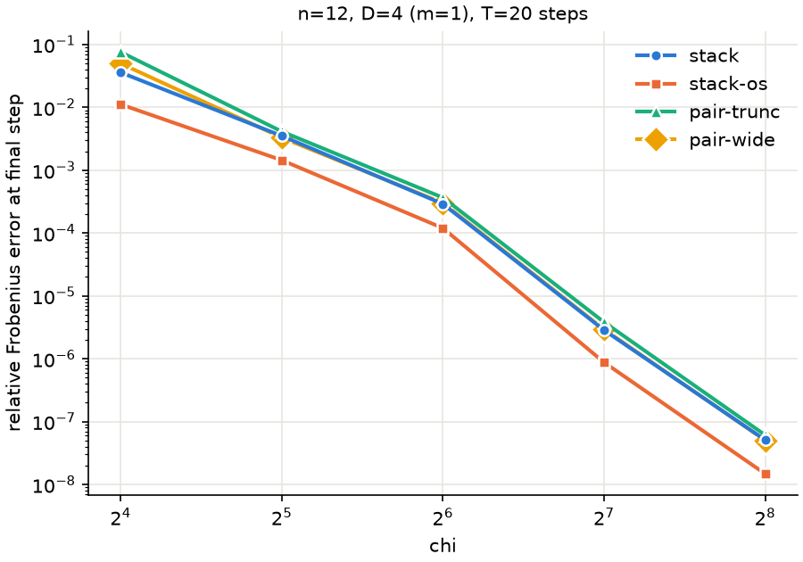

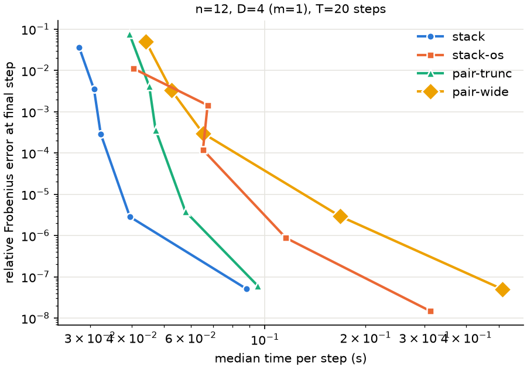

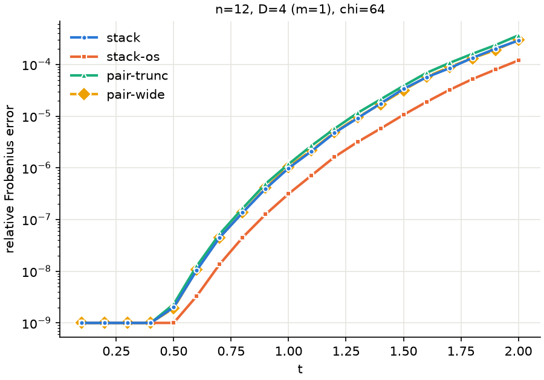

## n = 12, D = 16 (m = 2), t = 4

Error at the final step (`*`: at the inner-product floor, < 1e-7), median seconds per step, peak CuPy pool.

| chi | method | error | C(T) error | bond | s/step | pool GB |
|---|---|---|---|---|---|---|
| 16 | stack | 4.95e-01 | 2.1e-02 | 16 | 0.029 | 0.03 |
| 16 | stack-os | 2.74e-01 | 2.7e-03 | 16 | 0.039 | 0.04 |
| 16 | pair-trunc | 5.39e-01 | 1.7e-02 | 16 | 0.041 | 0.00 |
| 16 | pair-wide | 4.83e-01 | 1.1e-02 | 16 | 0.065 | 0.04 |
| 32 | stack | 1.74e-01 | 4.9e-03 | 32 | 0.033 | 0.12 |
| 32 | stack-os | 1.13e-01 | 3.7e-04 | 32 | 0.067 | 0.17 |
| 32 | pair-trunc | 2.01e-01 | 2.1e-03 | 32 | 0.047 | 0.01 |
| 32 | pair-wide | 1.74e-01 | 2.3e-03 | 32 | 0.164 | 0.16 |
| 64 | stack | 3.48e-02 | 1.5e-04 | 64 | 0.062 | 0.47 |
| 64 | stack-os | 1.64e-02 | 3.9e-05 | 64 | 0.093 | 0.97 |
| 64 | pair-trunc | 4.66e-02 | 5.4e-04 | 64 | 0.049 | 0.03 |
| 64 | pair-wide | 3.48e-02 | 5.2e-05 | 64 | 0.486 | 0.65 |
| 128 | stack | 3.86e-03 | 2.6e-06 | 128 | 0.256 | 1.87 |
| 128 | stack-os | 1.73e-03 | 5.4e-08 | 128 | 0.312 | 3.63 |
| 128 | pair-trunc | 4.92e-03 | 4.2e-06 | 128 | 0.060 | 0.10 |
| 128 | pair-wide | 3.98e-03 | 4.2e-06 | 128 | 1.795 | 2.36 |
| 256 | stack | 3.52e-04 | 1.3e-08 | 256 | 1.729 | 7.46 |
| 256 | stack-os | 1.34e-04 | 1.7e-09 | 256 | 1.543 | 15.62 |
| 256 | pair-trunc | 4.52e-04 | 1.8e-07 | 256 | 0.114 | 0.42 |
| 256 | pair-wide | 3.53e-04 | 9.7e-08 | 256 | 8.326 | 9.01 |

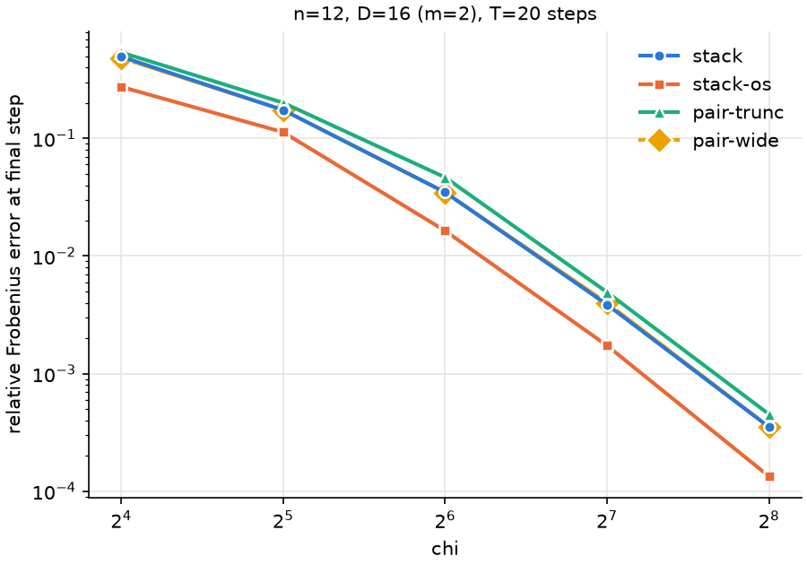

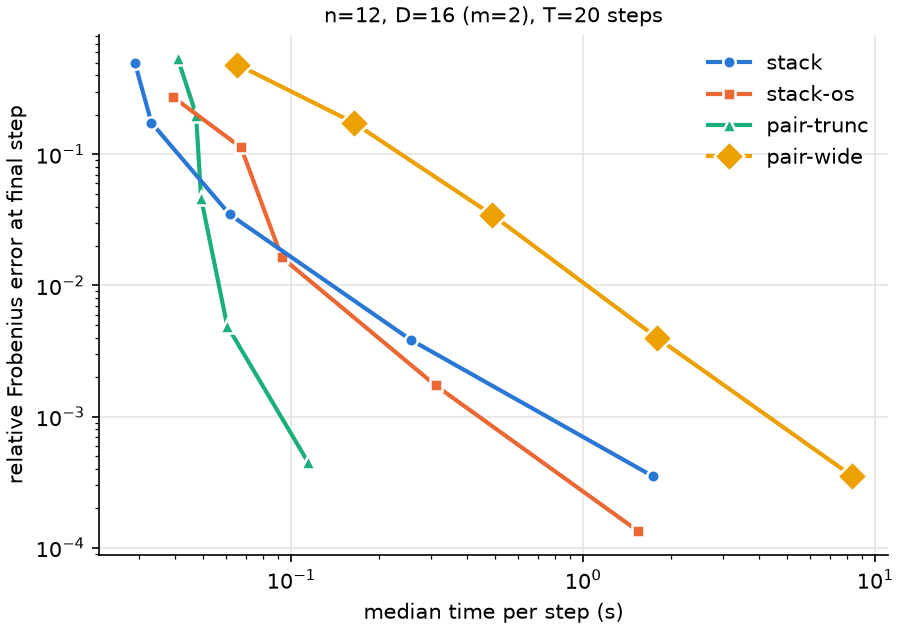

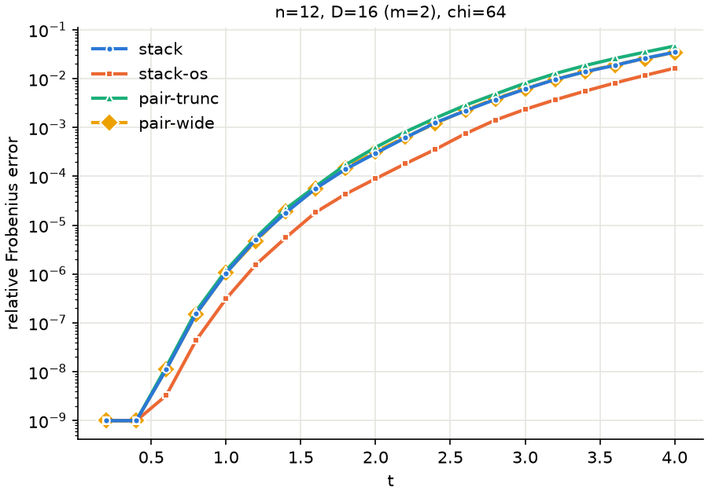

## n = 24, D = 4 (m = 1), t = 2

Error at the final step (`*`: at the inner-product floor, < 1e-7), median seconds per step, peak CuPy pool.

| chi | method | error | C(T) error | bond | s/step | pool GB |
|---|---|---|---|---|---|---|
| 16 | stack | 4.15e-02 | 1.6e-03 | 16 | 0.049 | 0.00 |
| 16 | stack-os | 1.12e-02 | 1.8e-05 | 16 | 0.073 | 0.01 |
| 16 | pair-trunc | 7.45e-02 | 9.3e-04 | 16 | 0.073 | 0.00 |
| 16 | pair-wide | 3.55e-02 | 1.7e-04 | 16 | 0.084 | 0.00 |
| 32 | stack | 3.27e-03 | 5.6e-06 | 32 | 0.056 | 0.02 |
| 32 | stack-os | 1.45e-03 | 1.7e-07 | 32 | 0.122 | 0.02 |
| 32 | pair-trunc | 3.86e-03 | 2.1e-05 | 32 | 0.087 | 0.00 |
| 32 | pair-wide | 3.43e-03 | 1.8e-06 | 32 | 0.105 | 0.02 |
| 64 | stack | 2.89e-04 | 1.9e-07 | 64 | 0.059 | 0.08 |
| 64 | stack-os | 1.20e-04 | 5.0e-09 | 64 | 0.143 | 0.10 |
| 64 | pair-trunc | 3.73e-04 | 1.5e-07 | 64 | 0.091 | 0.01 |
| 64 | pair-wide | 2.90e-04 | 2.2e-08 | 64 | 0.137 | 0.06 |
| 128 | stack | 2.96e-06 | 5.9e-10 | 128 | 0.078 | 0.31 |
| 128 | stack-os | 8.73e-07 | 3.0e-12 | 128 | 0.302 | 0.33 |
| 128 | pair-trunc | 3.94e-06 | 2.3e-09 | 128 | 0.117 | 0.05 |
| 128 | pair-wide | 2.96e-06 | 5.3e-10 | 128 | 0.291 | 0.21 |
| 256 | stack | 0.00e+00* | 4.0e-13 | 256 | 0.224 | 1.21 |
| 256 | stack-os | 0.00e+00* | 1.4e-14 | 256 | 0.937 | 1.50 |
| 256 | pair-trunc | 4.21e-08* | 8.4e-13 | 256 | 0.229 | 0.17 |
| 256 | pair-wide | 0.00e+00* | 2.4e-13 | 256 | 1.454 | 0.78 |

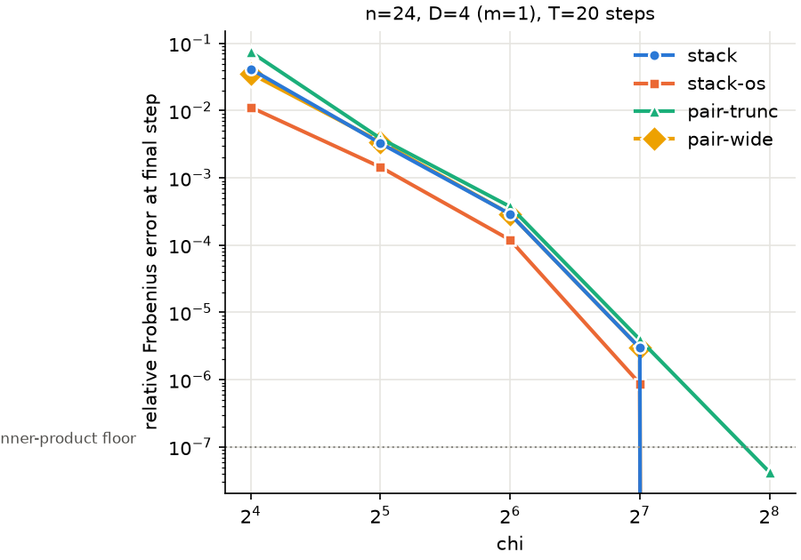

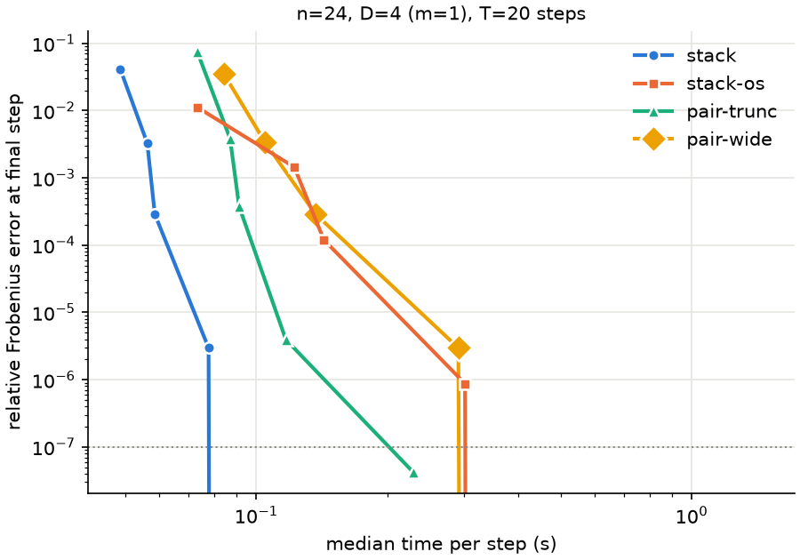

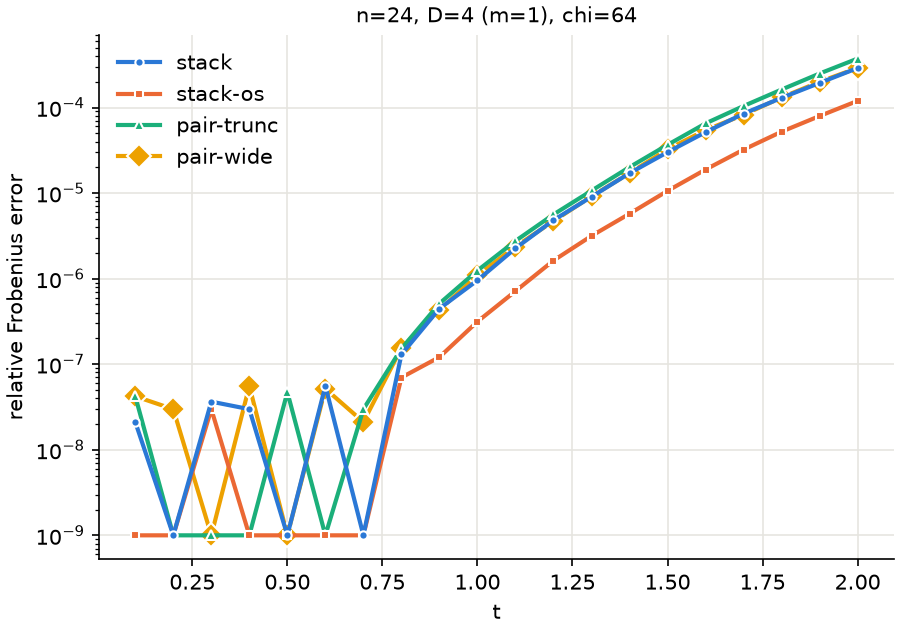

## n = 24, D = 16 (m = 2), t = 4

Error at the final step (`*`: at the inner-product floor, < 1e-7), median seconds per step, peak CuPy pool.

| chi | method | error | C(T) error | bond | s/step | pool GB |
|---|---|---|---|---|---|---|
| 16 | stack | 4.89e-01 | 2.1e-02 | 16 | 0.050 | 0.04 |
| 16 | stack-os | 2.75e-01 | 5.4e-03 | 16 | 0.071 | 0.07 |
| 16 | pair-trunc | 5.41e-01 | 1.2e-02 | 16 | 0.075 | 0.00 |
| 16 | pair-wide | 4.89e-01 | 5.5e-03 | 16 | 0.167 | 0.05 |
| 32 | stack | 1.74e-01 | 4.1e-03 | 32 | 0.061 | 0.17 |
| 32 | stack-os | 1.14e-01 | 9.6e-05 | 32 | 0.127 | 0.27 |
| 32 | pair-trunc | 2.07e-01 | 3.9e-03 | 32 | 0.087 | 0.01 |
| 32 | pair-wide | 1.74e-01 | 1.7e-03 | 32 | 0.293 | 0.20 |
| 64 | stack | 3.77e-02 | 7.8e-05 | 64 | 0.136 | 0.67 |
| 64 | stack-os | 1.65e-02 | 4.2e-05 | 64 | 0.221 | 1.28 |
| 64 | pair-trunc | 4.84e-02 | 9.5e-05 | 64 | 0.091 | 0.04 |
| 64 | pair-wide | 3.65e-02 | 7.1e-05 | 64 | 1.305 | 0.86 |
| 128 | stack | 3.89e-03 | 6.2e-06 | 128 | 0.707 | 2.68 |
| 128 | stack-os | 1.73e-03 | 1.2e-06 | 128 | 0.966 | 4.85 |
| 128 | pair-trunc | 4.98e-03 | 2.1e-06 | 128 | 0.118 | 0.15 |
| 128 | pair-wide | 3.93e-03 | 2.5e-06 | 128 | 5.456 | 3.17 |
| 256 | stack | 3.65e-04 | 1.5e-08 | 256 | 5.055 | 10.69 |
| 256 | stack-os | 1.31e-04 | 6.7e-09 | 256 | 5.478 | 20.47 |
| 256 | pair-trunc | 4.78e-04 | 1.0e-07 | 256 | 0.306 | 0.62 |
| 256 | pair-wide | 3.70e-04 | 2.1e-07 | 256 | 27.188 | 12.24 |

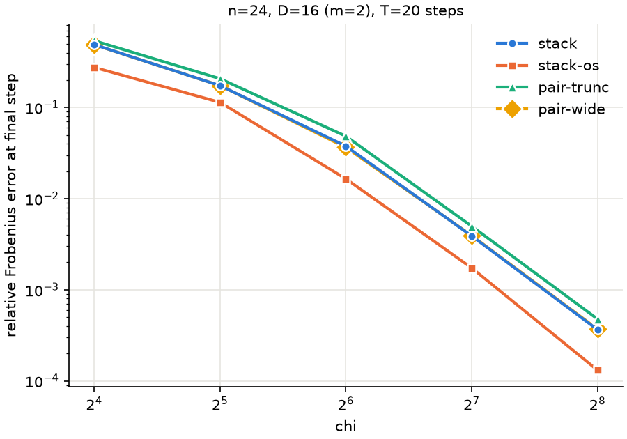

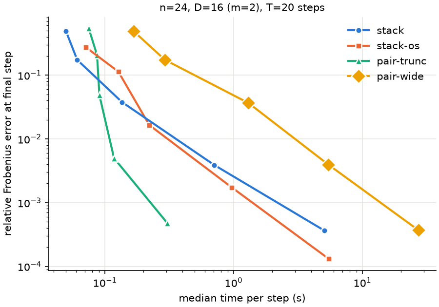

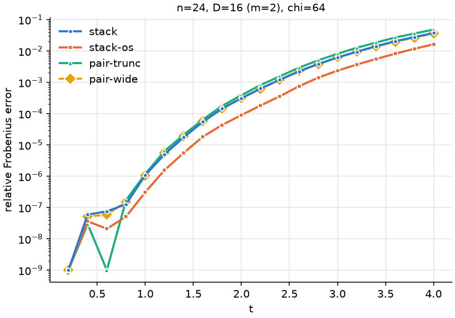

## Conclusion

Setup: `O = Z_c`, `O <- U^dag O U` for T = 20 steps, one A100, complex128,
`cutoff=0`, step `t` seeded with `2t` (`2t + 1` for the second half of a pair).
There is one seed per point, so the table has no error bars. The ratios below
hold at every `chi` and both chain lengths, which suggests they are systematic,
but differences under ~1.3x are not individually significant.

**At equal time, pair-trunc wins for thick layers (D = 16), and the stack wins
narrowly for thin ones (D = 4).**

- D = 16, n = 24: pair-trunc reaches 4.8e-4 at 0.31 s per step (`chi = 256`).
  At that time the stack is at `chi` 64-128, with errors of 3.8e-2 to 3.9e-3,
  8-80x worse. To match pair-trunc's error the stack needs `chi = 256` and
  5.1 s per step, 16x longer. n = 12 gives the same picture: 4.5e-4 at 0.11 s
  against 3.5e-4 at 1.7 s.
- D = 4: the stack costs the same as pair-trunc or less (n = 24: 0.05-0.22 s
  against 0.07-0.23 s) and is 1.2-2.1x more accurate. It is therefore the better
  choice at equal time, by a small margin. Oversampling costs 1.5-4x more time
  here, and spending it on a larger `chi` gives lower error: stack at
  `chi = 64` (0.06 s, 2.9e-4) beats stack-os at `chi = 32` (0.12 s, 1.4e-3).

**At equal `chi`, the stack is 1.1-1.3x more accurate than pair-trunc and sits
on pair-wide.** The pair-trunc/stack error ratio is 1.09-1.34 for D = 16, and
1.18-1.34 for D = 4 except at `chi = 16` (1.8-2.1). The stack matches pair-wide
to within 3% for D = 16. Both make a single `chi`-column randomized sketch of
the exact product, so the stack already reaches the pairwise ceiling; pair-wide
pays 3-10x the stack's time (up to 90x pair-trunc's) for nothing more. The only remaining lever is the sketch
itself: `oversample=None` (1.5x) lowers the error another 1.5-3.7x at the same
`chi`.

**Is the stack's accuracy worth its cost? Not for D = 16.** At `chi = 256` the
stack is 1.3x more accurate than pair-trunc for 16x the time and 17x the peak
pool (10.7 GB against 0.62 GB). That ratio exceeds the D/2 = 8 the flop count
predicts. The fixed contraction-path fix (`optimize="dp"`) has not landed (see
Provenance): these timings use opt_einsum's `auto` heuristic, and they look
like it chose poor paths. Stack time grows 7x from `chi` 128 to 256 at n = 24
(5.7x for stack-os), and at n = 12 stack is slower than stack-os at
`chi = 256` (1.73 s against 1.54 s). With better paths the gap should shrink
towards the predicted ~8x, which would still not pay for a 1.3x accuracy gain.
Rerun the D = 16 timings once the fix lands.

**Reference and floor.** U is the same MPO in every method and in both
references, so they share all of the Trotter error and none of it shows up in
these errors. n = 12 errors are dense Frobenius norms. The n = 24 reference is a
gate-by-gate canonical SVD evolution at bond 1024 and cutoff 1e-12. That is the
same exact-SVD truncation as contracting `U^dag O U` and compressing, but done
gate by gate: the whole sandwich would need bond `D^2 chi`, up to 262144. It
agrees with the dense evolution to 8e-12 (n = 8, `checks.json`). At D = 16 it
reaches the 1024 cap from t = 2.6. Its rigorous truncation bound at t = 4 is
1.5e-6, and it differs from the 512 reference by 3.8e-6. The bound is 90x and
the difference 35x below the smallest D = 16 method error (1.3e-4). At D = 4 the bond stays
at 631 or below, so the cutoff alone sets it (bound 6e-10). The n = 24, D = 4,
`chi = 256` rows sit at the inner-product floor (marked `*`): all four methods
are exact there to about 1e-7.
